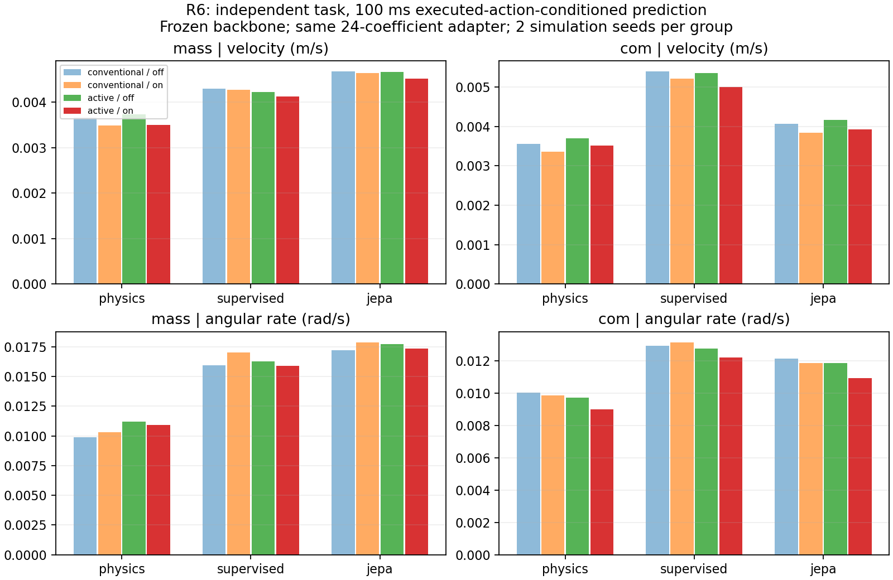

# R6 冻结主干在线适应：实测报告

完成 8/8 条有界 Gazebo 在线影子试验和一次未解锁检查。安全/数据门：全部通过；JEPA 预测收益门：失败；学习控制放行：**否**。这次确实运行了在线小矩阵更新，不再只是离线训练或历史窗口推理，但仍未证明无需手调的负载动力学适应已经成功。

## 可核对结果

八槽累计墙钟 942.3 s（上限 1440 s）。七组影子方法在各次同一轨迹上运行；实际学习控制飞行为 0。所有网络文件及内存张量哈希保持不变，在线/离线最大预测差 1.4e-08。最大单次消息接收到处理延迟 P95 57.77 ms；最大单模型推理+更新 P95 0.518 ms。延迟不含未测得的源发布到 DDS 接收部分，不能称完整硬实时保证。

| 条件 | 安全/数据 | 独立任务位置 RMSE / 峰值 cm | 姿态 RMSE ° | 慢更新次数 / 秩 | 新最终 hover 门 |
|---|---|---:|---:|---:|---|
| s0_00_mass_active | PASS | 2.00 / 3.51 | 4.072 | 49 / 2 | PASS |
| s0_00_mass_conventional | PASS | 1.92 / 3.57 | 4.049 | 49 / 3 | FAIL |
| s2_00_mass_active | PASS | 2.27 / 4.51 | 4.123 | 49 / 2 | FAIL |
| s2_00_mass_conventional | PASS | 2.27 / 4.42 | 4.053 | 49 / 3 | FAIL |
| s0_00_com_active | PASS | 1.87 / 3.37 | 2.344 | 49 / 2 | FAIL |
| s0_00_com_conventional | PASS | 1.80 / 3.40 | 2.354 | 49 / 3 | FAIL |
| s2_00_com_active | PASS | 2.37 / 4.47 | 2.352 | 49 / 2 | FAIL |
| s2_00_com_conventional | PASS | 2.29 / 4.44 | 2.358 | 49 / 3 | FAIL |

位置/姿态为既有控制器执行主动/常规参考时的结果，不是学习控制收益。新 hover 门检查 71–72 s；旧 oracle 恢复门仍未修复、未重验，二者不可互相替换。
位置诊断还发现：种子 2 的四条试验，从 45–48 s 到 71–72 s，真实机体 Y 位移为 −8.40～−8.85 cm，估计位置变化为 −3.59～−3.99 cm，二者变化相差约 +4.7～+4.9 cm。因此不能用较小的估计器跟踪误差掩盖真实漂移。这是相对位移诊断，不是绝对真值跟踪误差，也不能唯一归因于某个滤波器参数；详见 results/recovery_diagnosis.json。

## 独立任务预测对照

表中为估计器标签，58–67.5 s 起点。单位分别为 m/s、rad/s。神经方法汇总三个模型种子、每条件两个仿真种子；对每条轨迹的 RMSE 作平方均值开方。它不是把滑窗或模型种子当独立飞行的显著性检验。所有时域都使用区间内实际收到的执行器指令，属于事后动作条件预测。

| 环境 | 方法 | 时域 ms | 主动：更新关 v / ω | 主动：更新开 v / ω | 常规：更新开 v / ω |
|---|---|---:|---:|---:|---:|
| mass | physics | 100 | 0.00373 / 0.01119 | 0.00350 / 0.01091 | 0.00349 / 0.01033 |
| mass | physics | 200 | 0.00736 / 0.02044 | 0.00686 / 0.01983 | 0.00683 / 0.01904 |
| mass | physics | 400 | 0.01575 / 0.03673 | 0.01474 / 0.03558 | 0.01493 / 0.03441 |
| mass | supervised | 100 | 0.00422 / 0.01628 | 0.00412 / 0.01590 | 0.00427 / 0.01701 |
| mass | supervised | 200 | 0.00891 / 0.03081 | 0.00866 / 0.03007 | 0.00907 / 0.03280 |
| mass | supervised | 400 | 0.02381 / 0.06615 | 0.02341 / 0.06603 | 0.02438 / 0.07003 |
| mass | jepa | 100 | 0.00466 / 0.01772 | 0.00452 / 0.01735 | 0.00463 / 0.01787 |
| mass | jepa | 200 | 0.01040 / 0.03649 | 0.01012 / 0.03607 | 0.01036 / 0.03692 |
| mass | jepa | 400 | 0.02946 / 0.08625 | 0.02908 / 0.08619 | 0.02960 / 0.08614 |
| com | physics | 100 | 0.00370 / 0.00971 | 0.00352 / 0.00898 | 0.00335 / 0.00987 |
| com | physics | 200 | 0.01096 / 0.01757 | 0.01057 / 0.01594 | 0.01070 / 0.01793 |
| com | physics | 400 | 0.08929 / 0.03159 | 0.08877 / 0.02831 | 0.09034 / 0.03312 |
| com | supervised | 100 | 0.00536 / 0.01276 | 0.00500 / 0.01219 | 0.00521 / 0.01314 |
| com | supervised | 200 | 0.01409 / 0.02412 | 0.01347 / 0.02316 | 0.01402 / 0.02597 |
| com | supervised | 400 | 0.09506 / 0.05024 | 0.09448 / 0.04870 | 0.09620 / 0.05670 |
| com | jepa | 100 | 0.00417 / 0.01184 | 0.00392 / 0.01092 | 0.00384 / 0.01187 |
| com | jepa | 200 | 0.01258 / 0.02287 | 0.01204 / 0.02118 | 0.01228 / 0.02381 |
| com | jepa | 400 | 0.09286 / 0.04714 | 0.09219 / 0.04426 | 0.09386 / 0.05109 |

完整 100/200/400 ms、辨识/独立任务、估计器/真值绝对状态/真值增量的分组结果在 `results/all_metrics.csv`；各窗口原始误差 CSV 在本地复现包。真值从未参与训练标准化、模型选择或在线更新。

## 登记门槛与适应时间

- mass：主动更新相对关闭，速度改善 3.04%，角速度改善 2.06%；主动相对常规更新，速度改善 2.49%，角速度改善 2.89%。登记判定 FAIL。
- com：主动更新相对关闭，速度改善 6.02%，角速度改善 7.78%；主动相对常规更新，速度改善 -1.96%，角速度改善 7.98%。登记判定 FAIL。

0/56 个方法×轨迹组合达到辨识窗内连续 2 s 的双指标≥10%改善，其余按 8 s 右删失报告，不虚构恢复时间。该口径只看更新前的滚动辨识误差，不代替独立任务泛化。每次辨识提供约 80 个区间，另有 10 s hover 标定预算。

## 失败与限制定位

1. 首条主动质量试验回归协方差特征值约 0.0150、0.0284、0.9905、4.7069；门限 0.05 下只更新两个方向。最弱方向主要是垂向比力，次弱为滚转。姿态激励能量匹配不等于对质量/所有惯量充分激励。此秩是四维回归量的秩，不是八个物理参数的可辨识秩。
2. 合成残差脉冲压力测试：在辨识窗 51–53 s 给已记录标签添加峰值 0.3 m/s² 的短脉冲，最大持久 W 差 0.38837。这是软件敏感性测试，不是真实风仿真；结果说明中心化和固定更新窗仍不能保证瞬态扰动不写入慢系数。
3. 旧训练动作只来自 20 Hz 快照；新测试逐回调动作通常更密。没有用无法获得的原生动作填补旧数据。名义倾转角来自固定 80/100 ms 观测器，未验证未知舵机动态。
4. W 只修正物理状态读出，不反馈到潜空间转移；未训练环境潜变量或元学习支持/查询适应。被冻结的网络不等于完整环境条件化世界模型。
5. 标签为估计器状态，Gazebo 真值只独立评价。估计器偏差可能被学入模型；完整表同时给真值绝对和增量误差。低估计器误差不能直接作为物理准确性或控制价值证明。
6. 旧 oracle 接口仍存在整体位置恢复失败；本轮不把平均残差直接反号送入加速度端口，也没有靠放松该门来解锁控制。控制链原零路径和 9 项限幅/回退测试通过，只证明守住关闭状态。
7. 本轮未知环境仅两类、每类两种噪声种子；未新增惯量/舵机、飞行中参数阶跃、真实风或组合测试。未达到初始收益与扰动隔离要求，因此不扩大训练或进入学习控制试验。

## 公平性、实现与溯源

离线训练四条完整轨迹 1980 窗口，验证一条 495 窗口。六个模型各 8382 参数，固定 24 epoch，训练合计 21.98 s。神经方法同结构/数据/优化步数，JEPA 的未来编码/非塌缩计算使实际计算量更大，不宣称 FLOP 完全匹配。模型/损失/输入输出/24系数及10个初始化统计量详见 [MODEL_zh.md](MODEL_zh.md)。
主动/常规同 8 s、同最大角度界限，解析采样积分的指令角能量均约 0.001028084 rad²·s。4/4 配对通过已有起始状态统计匹配门；仍不是同一全状态分叉。
首条 post-run 的 NumPy 布尔序列化和更新窗口起止端点误用已修复；原失败验收与停止记录保存在 audit_repairs，没有重飞、换种子或改变模型。见 [AMENDMENTS_zh.md](AMENDMENTS_zh.md)。
原 Controller/PX4 的 HEAD 和 14 个既有脏文件哈希未变。无实机、无 remote 配置更改、无强推。原始日志保留本机；交付前逐文件散列，包内文件重新打开验证。复现步骤见 [REPRODUCE_zh.md](REPRODUCE_zh.md)。

## 与论文的关系

[Neural-Fly](https://arxiv.org/html/2205.06908v2) 已使用离线表示与在线小系数适应；本轮没有复现其组合自适应律及稳定性证明，不能把这个大方向称首创。
[T2-z](https://arxiv.org/html/2610.22364v1) 的冻结模型/测试环境潜变量优化为慢适应提供参考；本实现是读出矩阵，并未实现其环境潜变量训练。
[ReDRAW](https://arxiv.org/html/2504.02252v1) 研究冻结世界模型上的潜空间动态残差；本轮没有替换为其想象轨迹/RL策略。
[SkyJEPA](https://arxiv.org/html/2606.23444v2) 的动作条件潜预测、非塌缩和物理读出是结构参考；论文规划器可以提供候选未来动作，本 PX4 链路不能据此假设未来执行器动作已知。

下一步应先补充垂向/执行器可辨识性与扰动隔离证据、重建动作采样一致的训练集，并独立修复与重验 oracle 整体控制门；当前结果不支持继续加大 JEPA 训练来宣称闭环收益。
