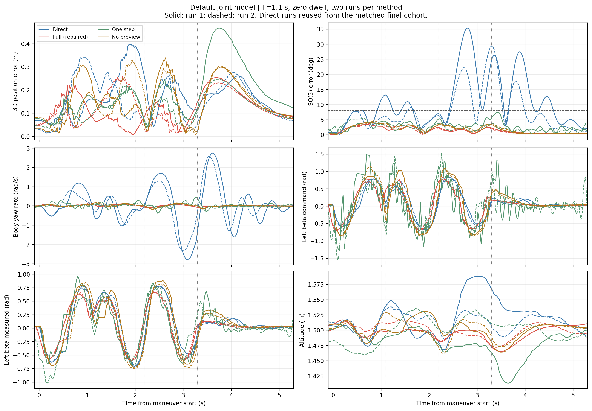
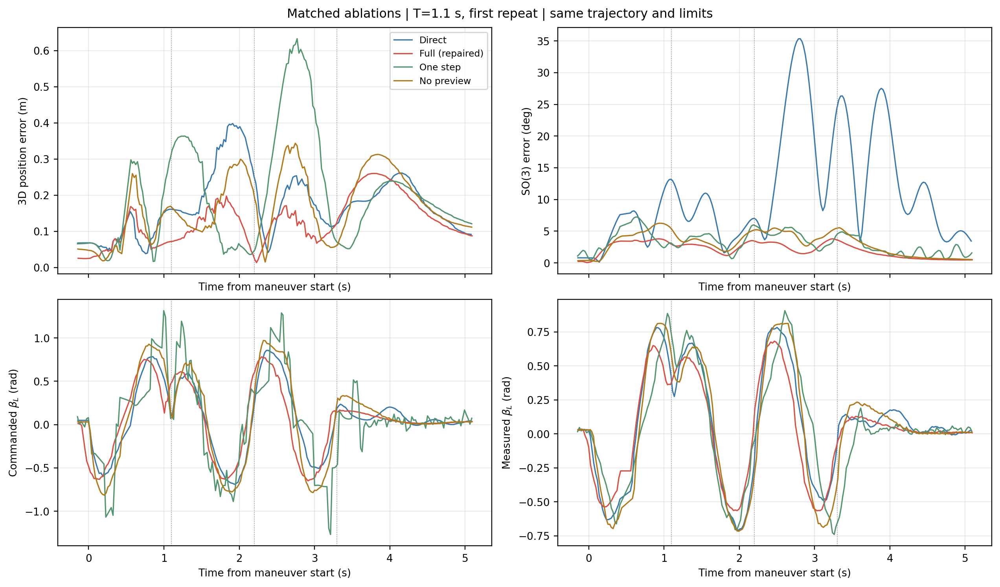

# DRCDA 理论、实现与无延迟 Gazebo 验证复核

日期：2026-10-09。固件：`PX4-Autopilot-Hnuter-tail-sitl`，提交
`49b60a5d8775655c1e6a9be722f76e9e4ab2517b`。外部控制修改前提交：`6e35ba3`。
全部实验使用原 Gazebo JointPositionController，不增加纯延迟，也不切换到延迟固件。

## 结论与证据边界

此前的问题不能全部归结为“外环参考太激进”。本次证实了约束与仿真模型不一致、
抗饱和符号和时间基准错误、输入与预测状态混用、约束求解与日志/评估缺陷。
改正这些问题之后，仍存在快速带载运动中的模型误差。本次用两段已有 Direct
仿真日志拟合无纯延迟的加载响应候选，再用新仿真验证。候选改善了部分飞行结果，
但独立命令回放的角度预测误差反而变大，不能称为更准确的物理辨识。
补跑原零重力模型的同工况 Full 两次均通过，姿态指标也更好，因此保留原模型为默认。

最终试验与探索阶段分开记录。实验结果是 SITL 证据，不是实机飞行证明；
每种方法两次重复能够观察一致性，但不足以作显著性或可靠性概率的结论。
所有成功与失败结果均在 `audit_metrics.csv`、`audit_metrics.json` 和 `data/` 中保留。
默认模型的 T=1.0 s 探索运行仍超过滚转/俯仰阈值；不能宣称所有快速工况已经解决。
本次 T=1.1 s 为探索后选定的复核工况，不是预先注册的独立性能极限测试。
后续需要在固定配置下扩大 T 扫描和重复次数，才能给出可靠的最短切换时间。

### 默认模型：优先复核的配置

| 方法 | 通过 | 3D位置峰值/m | SO(3)峰值/deg | 滚转俯仰峰值/deg | 偏航角速度峰值/(rad/s) |
|---|---:|---:|---:|---:|---:|
| Full | 2/2 | 0.254 - 0.260 | 3.410 - 3.931 | 2.711 - 2.921 | 0.118 - 0.158 |
| Direct | 0/2 | 0.340 - 0.398 | 29.488 - 35.360 | 5.639 - 8.586 | 2.575 - 2.784 |
| No preview | 2/2 | 0.330 - 0.340 | 4.180 - 4.659 | 3.306 - 3.514 | 0.171 - 0.187 |
| One step | 0/2 | 0.247 - 0.468 | 5.455 - 7.534 | 5.420 - 5.523 | 0.291 - 0.462 |

数值为两次重复的最小值至最大值，不是置信区间。工况 T=1.1 s、每段 1.2 m、
无停留连续 A→B→A→C。默认模型 Full 与消融分别补跑；Direct 为此前同工况
最终组的两次运行复用，不是同时成对试验。所有组使用同一外环与物理约束。



### 加载拟合候选：保留的探索结果，不设为默认

| 方法 | 通过 | 3D位置峰值/m | SO(3)峰值/deg | 滚转俯仰峰值/deg | 偏航角速度峰值/(rad/s) |
|---|---:|---:|---:|---:|---:|
| Full | 2/2 | 0.247 - 0.260 | 3.794 - 4.556 | 3.681 - 3.916 | 0.170 - 0.171 |
| Direct | 0/2 | 0.340 - 0.398 | 29.488 - 35.360 | 5.639 - 8.586 | 2.575 - 2.784 |
| No preview | 0/2 | 0.341 - 0.344 | 5.812 - 6.250 | 5.267 - 5.570 | 0.247 - 0.258 |
| One step | 0/2 | 0.609 - 0.633 | 6.455 - 7.235 | 6.174 - 6.329 | 0.245 - 0.366 |



### 全部实验的记录范围

共 42 个已记录的实际 SITL 工况。以下包括探索失败，不能把它们和最终
同参数重复混为统计样本，也不能用筛选后的成功数代表整体可靠性。

| 阶段 | 数量 | 通过 |
|---|---:|---:|
| before | 2 | 0 |
| pilot | 4 | 1 |
| validation | 11 | 3 |
| matched_pilot | 4 | 1 |
| loaded_candidate | 6 | 3 |
| final | 8 | 2 |
| nda_recheck | 1 | 0 |
| model_ablation | 2 | 2 |
| default_ablations | 4 | 2 |

验证：52 项自动测试通过；固件源码未修改。测试集覆盖约束求解、抗饱和、日志列宽、轨迹与评价边界。


## 1. 理论对应与实现问题

### 1.1 当前 Full 的准确定位

状态是四个关节角与五个旋翼推力，输入是四个关节位置命令与五个推力命令。
每次分配先更新电机状态估计，再用 Gazebo 实测关节角覆盖角度状态。
动力学传播产生 `q_H=Phi_H(q_measured,u)`，灵敏度递推产生 `S_H`，
线性化矩阵为 `B_H=G(q_H) S_H`。

Full 在 H1=0.05 s、H2=0.10 s 保持同一个候选输入，采用两次 Gauss-Newton：

```text
min_u 0.5 ||W(w_hat_H1(u)-w_d(k+H1))||^2
    + 1.0 ||W(w_hat_H2(u)-w_d(k+H2))||^2
    + ||u-u_previous||^2_Rdelta + ||u-u_preferred||^2_Rpref
```

这属于基于微分线性化的短时域预测分配。多点目标启用时，旧的 jerk/rate
残差不再参与求解，因此不能把当前 Full 描述为原论文方程的逐项复现。
未来参考采用同一轨迹的解析采样和冻结当前跟踪误差的外环评估；它不是完整飞行器状态预测。
本次没有改变轨迹参考或引入 reference governor。
预测仍采用一阶近似，并未辨识出 Gazebo PID 的完整二阶负载耦合动力学。
因此误差下降支持当前实现的工况收益，但不证明预测器已物理精确或闭环全局稳定。

### 1.2 物理状态约束与命令约束混淆

原 `gazebo_joint_pid_no_delay()` 只替换 K/tau 和纯延迟，没有替换继承来的
旧舵机速率：二级约 +3.252/-2.886 rad/s。当前 SDF 四个倾转关节的速度界均为
10 rad/s；实测 Direct 日志也出现了超过 8 rad/s 的二级角速度。
同时 Direct 命令 slew 为 50 rad/s，而 DRCDA 二级仅为 4 rad/s。

修复后区分两种量：预测状态的物理角速度界为 10 rad/s；输入变化率界为
50 rad/s，与 Direct 一致。它们不是同一个物理量，不能互相替代。
放宽到正确边界后，初始零重力模型的 T=1.0 Full 并未改善，说明旧约束也有
保守整形作用；不能把这种整形当成预测机制的优势。

### 1.3 无约束解后截断不等于约束最优解

旧实现计算无约束 GN 步长后逐通道裁剪。某个执行器饱和后，剩余执行器没有
重新分配残差。新增小规模 active-set box-QP：每次固定命中边界的变量，
重解自由变量，并检查 KKT 条件；主框架仍是 move blocking 和两次 GN。
相关测试包括耦合饱和后重新分配，以及 80 个随机正定问题的 KKT 检查。
这改善每次局部子问题求解，不构成整个非线性闭环的全局稳定性证明。

### 1.4 抗饱和符号与时间一致性

外环积分定义为 `I += (p_d-p) dt`，并以 `+Ki*I` 增加期望加速度。
因此回算应使用正号：

```text
I_dot = position_error + k_aw * (a_estimated - a_requested) / Ki
```

旧代码在此多了负号，推力不足时可能继续增大积分。
此外，`w_H - w_d(k)` 混合未来预测和当前参考，含有有意的预见变化，
不应直接当作饱和残差。本次改用同一时刻的 `w_estimated(k)-w_requested(k)`。
估计 wrench 仍依赖执行器模型，不能视作真实测力。

### 1.5 仿真输入与内部状态混用

独立 DRCDA 仿真入口原来返回预测器的 `state[:4]` 作为舵机输入，
而测量闭环入口返回 `command[:4]`。前者相当于先经过内部模型，再进入 Gazebo PID，
与优化器的输入定义不一致。现统一发布命令，实测/预测状态只用于反馈和预测。

### 1.6 日志和评估问题

- 未初始化时，父类通过动态分派调用子类表头长度，子类又追加自己的字段。
  部分启动行有 247 列，表头只有 204 列。修复为父类只填自己的字段。
- 原图把结束后被冻结的任务 elapsed 当作时间轴，造成末端竖线。
  现使用持续增长的遥测时间，并按任务起点对齐。
- 原位置峰值只计算 XY，且位置/姿态只评价移动段。
  现使用三维欧氏误差，覆盖 A→B 起点至末段悬停，包括中间停留。
- 历史 CSV 原样归档。分析仅剔除列宽错误的启动/等待解锁行；遇到飞行行列宽
  异常会报错。各文件剔除数量和 SHA-256 均有记录。

## 2. 闭环响应模型与辨识限制

原模型来自零重力 0.4 rad 阶跃，二级 K 约 0.90、tau 约 0.09 s。
本次探索性拟合使用修改前 T=1.0 Direct 和旧约束阶段 T=1.2 Direct 的实际日志：

| 关节 | K | tau/s |
|---|---:|---:|
| alpha_L | 1.0563 | 0.1464 |
| beta_L | 1.0607 | 0.0730 |
| alpha_R | 1.0035 | 0.1327 |
| beta_R | 1.0683 | 0.0716 |

离散方程仍为 `q_next=q+(1-exp(-dt/tau))*(K*u-q)`，随后施加物理速率界。
没有加入纯延迟；正反方向使用同组参数，因为这批闭环数据不足以独立辨识方向不对称。
这不是独立激励下的无偏辨识，K>1 也可能吸收未建模的二阶响应。
因此该配置显式放在实验目录，通过 `HNUTER_SWITCH_JOINT_MODEL` 选择。
`fit_gazebo_joint_response.py` 可从归档训练 CSV 重新导出参数与数据校验值。

`04_heldout_joint_model_check` 用最终实验的同一组实际命令序列离线回放两个模型，
比较 H1/H2 实测角误差。这是模型交叉校核，不是在线系统预先知道未来命令。
H=0.10 s 时，原模型四关节 RMSE 为约 [0.0055, 0.0437, 0.0133, 0.0367] rad，
加载候选为约 [0.0061, 0.0686, 0.0137, 0.0705] rad，候选均未改善。
因此不能把加载候选的飞行改善归因于预测准确性，应视为经验性调参；不设为默认。

## 3. 预测误差的独立性

历史 0.74 N / 1.98 N 是 `predicted future wrench - future model-estimated wrench`。
两者共享几何和推力模型，不能据此断言真实未来力误差同样小。
此外，move-blocking 假设输入保持，但闭环后续会重新求解，未来实际输入可能不同。

本次额外使用 EKF 速度的离线平滑微分，结合姿态、质量和重力重构净力，
图 `03_prediction_independent_crosscheck` 同时展示两种对照。
该净力包含阻力，速度微分也有噪声和约 0.14 s 窗口平滑，仍不等同于力传感器。
电机推力目前为模型估计而非实测；尾电机模型的速度一阶响应与推力一阶近似、
动臂惯性及几何误差，仍是下一步需要单独辨识的因素。

## 4. 对比与消融设计

共用同一个外环、轨迹、力/角度界、物理速度界和命令变化率界。
任务为 A=(0,0,1.5)→B=(0,1.2,1.5)→A→C=(0,-1.2,1.5)，
实际水平起点随任务启动位置平移；每段距离 1.2 m。
最终实验每段 T=1.1 s，点间停留为 0，结束后继续检查 2 s，重复两轮并反转方法顺序。
这是连续反向扰动实验，而非只有单次穿门的演示。

| 方法 | 具体差别 |
|---|---|
| Direct | 原解析分配，使用同一外环和仿真执行器 |
| Full | 实测角校正 + 加载响应候选 + 两点未来 wrench + 约束 GN |
| No preview | 与 Full 相同模型、时域、权重和求解器，只把未来 wrench 改为当前 wrench |
| One step | 相同模型/求解器，目标合并为一个 0.01 s 点，总跟踪权重仍为 1.5 |
| With nearfield（探索） | 额外增加下一步升力/力矩目标；结果恶化，未设为默认 |

No preview 是单因素检验预见作用的主要消融。One step 同时改变有效灵敏度，
其结果不能被过度解读为所有瞬时分配方法的性能。
三种闭环方法的目标轨迹和外环参数相同，但实际状态不同，因此最终反馈 wrench
不会逐点相同；报告不声称闭环记录中的 w_d 数值完全一致。
日志中的 `pre_reversal_servo_reduction_rad` 是角幅变化量，不是提前换向时间，
不能单凭这个数就证明 Full 比 No preview 更早换向；舵机时序需结合参考、命令与实测曲线解读。

判定标准保持：位置峰值 ≤0.75 m、SO(3) 峰值 ≤8°、滚转/俯仰 ≤5°、
最低高度 ≥0.5 m、门净空 ≥0.05 m、到达各目标、无失锁/停机失败。
T=0.8 s、1.2 m 的 minimum-jerk 峰值加速度为约 10.83 m/s²，已超过
共同外环的 8 m/s² 上限，因此不能要求仅靠分配器精确完成这一参考。

## 5. 与 Cuniato 论文的关系

本地论文第 7 式为 `w_dot=k_j*(w_d-w(q))`；第 9-12 式用执行器上下速率界
构造归一化和偏置；第 13 式统一缩放整组归一化速度；第 14 式要求反演执行器动态。
Basic DA 的逐项截断和命令代替测量，不是上述完整方法。

本次单独尝试了实测关节反馈、归一化、统一缩放、动态反演的 NDA 力坐标适配。
模型悬停单测还检查了非对称速率界下的零运动偏好：缺少正确的零空间偏好会
造成不必要的内部执行器运动。相关失败工况原样归档。
该适配没有论文第 15-19 式所需的真实电机功率参数，不能称为 PDA 完整复现。
未通过独立悬停/轨迹资格验证的 NDA 工况不进入最终优势结论。

## 6. 复现

在外部控制仓库根目录执行自动化实验（会自行启动并清理 PX4、Gazebo 和 DDS Agent）：

```bash
source /opt/ros/jazzy/setup.bash
source /home/hnuter/px4_ws_ros2/install/setup.bash
export OPENBLAS_NUM_THREADS=1
unset HNUTER_SWITCH_JOINT_MODEL
/home/hnuter/px4_ws_ros2/px4-venv/bin/python \
  tools/experiments/run_fixed_attitude_switching.py \
  --output "$PWD/hnuter_logs/audit_manual_recheck" \
  --duration 1.1 --dwell 0 --post-hold 2 --repeat 2 \
  --method full --method direct --method no_preview --method no_horizon
```

加 `--gui` 可显示 Gazebo。控制器测试属于仿真，不将该实验拟合直接用于 hardware。
上面的命令使用保留的默认模型。复现探索性的加载候选表时，另设
`HNUTER_SWITCH_JOINT_MODEL=$PWD/config/experiments/gazebo_loaded_joint_response.json`。
两个配置的结果必须分开解读。图 01-05 为候选组，图 06 为默认模型组；
Direct 不使用舵机预测模型，两组共用同一对 Direct 原始运行，不重复计作新实验。

## 7. 文件索引

- `audit_metrics.csv/json`：所有阶段统一重算后的结果。
- `data/`：原始诊断 CSV、原始结果、统一重算结果、有效参数、模型配置。
- `figures/`：连续换向曲线、消融指标、预测独立校核、关节模型回放。
- `source_changes.patch`：本次已跟踪代码的修改快照；新文件另列于 `source_inventory.json`。
- `source_before.tar.gz`：修改前控制器、工具、配置和测试的备份。
- `source_final.tar.gz`：最终控制器、工具、配置和测试的可复现快照。
- `run_manifests/`：每个阶段的固件、工况和执行顺序记录。

代码主要位于 `controllers/common/hnuter_drcda.py`、
`controllers/simulation/hnuter_external_direct_drcda.py`、
`controllers/experiments/fixed_attitude_switching/` 和 `tools/experiments/`。
