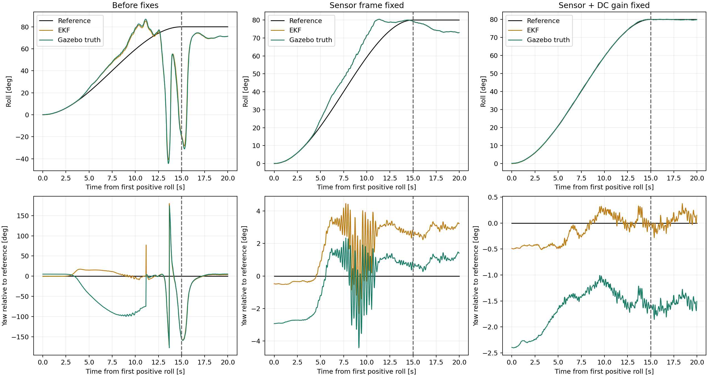
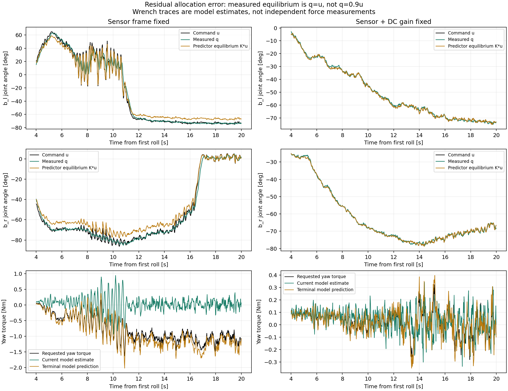
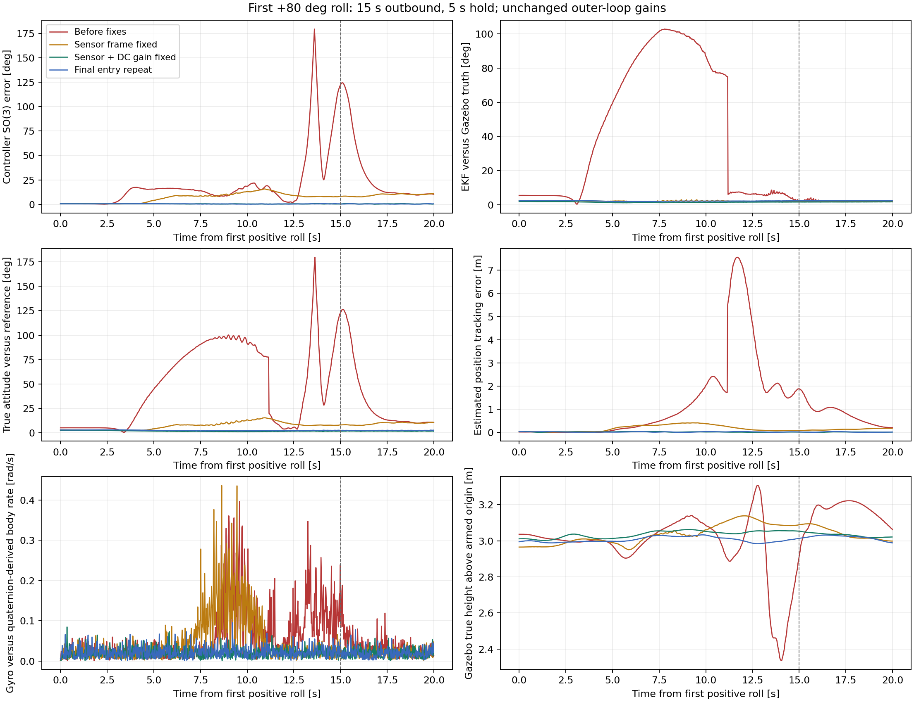
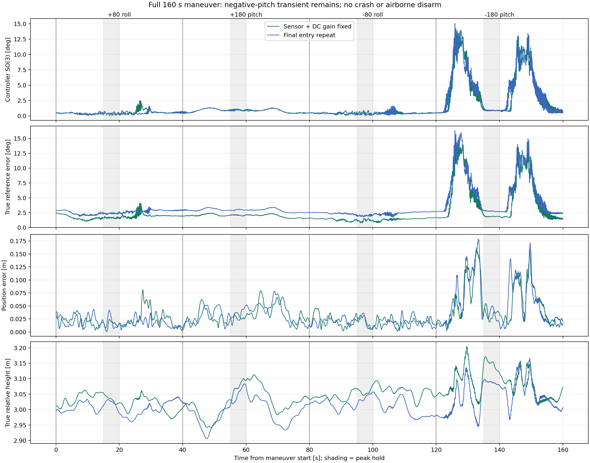

# 首次正横滚误差定位与大姿态复测

2026-10-12。本次针对首次正横滚去程的巨大姿态误差，定位并修复两处问题：Gazebo 磁场坐标转换不一致，以及分配预测器错误的舵机静态增益。没有调整姿态环增益或减慢轨迹。修复后，两次完整可视化复测均完成 160 秒任务；首次正横滚恢复准确跟踪，但负俯仰中段仍有约 14–15 度瞬态误差，不能宣称所有大姿态性能问题已解决。

## 条件与证据范围

- 固件仅使用 `/home/hnuter/PX4-Hnuter/PX4-Autopilot-Hnuter-tail-sitl`，无附加执行器纯延迟。没有使用延迟仓库，没有切换分支。
- 控制入口为 `controllers.experiments.maneuver_revision`，Full DRCDA，实测关节反馈，0.05/0.10 秒预测，move blocking 与 Gauss–Newton 保持不变。
- 顺序：+80 度横滚、+180 度俯仰、-80 度横滚、-180 度俯仰。每段 15 秒去程、5 秒峰值保持、15 秒返回、5 秒水平稳定。悬停高度 3 米。
- 直接发布电机、舵机控制。ULog 中 OFFBOARD 且 armed 的所有控制模式样本均显示：PX4 position、velocity、attitude、rates、allocation 控制标志为 0。保留的 thrust-setpoint 仅是此前着陆检测提示，不作为 PX4 内环分配输入。
- 外环增益、质量、执行器角度与速率约束、模型关节 PID 均未因本次修复改变。没有用 Gazebo 真值代替 EKF 控制反馈。
- 原始失败日志用于历史基线；本次新增一次仅传感器修复、一次传感器加静态增益修复、一次正式入口复测。不是多算法统计对比，也不是实机验证。

运行配置逐字段对照见 [runtime_config_deltas.json](evidence/runtime_config_deltas.json)。除静态增益和新增诊断标记外，仅有约 4 毫秒以内的起飞等待时序差异。ULog 参数快照表明仅气压自动校准偏置有自然变化；磁场校准和控制参数没有手动重置。初值与运行中参数变化分别保存在参数 JSON 和 [ulog_mode_checks.json](evidence/ulog_mode_checks.json)。

## 第一层原因是错误磁场输入导致估计偏航失真

原始日志在正横滚开始后约 4 秒，期望横滚约 14.3 度，估计横滚与真值横滚仍接近，但估计姿态与真值的 SO(3) 差已达 33.9 度。约 8 秒时该差达到 102.8 度附近，主要体现为偏航分离。控制器根据错误航向计算姿态误差和机体系力，随后才出现更大的真实运动偏离与力矩饱和。

旧桥接代码把磁强计机体系输入转换成 `[-y,-x,z]`。Gazebo 旧兼容配置使用 NED 地磁分量，而模型姿态在 ENU 世界中旋转；机体倾转后，不能再通过交换机体系轴来补偿世界坐标约定。上游 Gazebo 提供明确的单位和地球坐标系选项，见 [Gazebo 官方 PR 2460](https://github.com/gazebosim/gz-sim/pull/2460)。

修复是成对修改，而非仅改一个符号：

1. 两份 `server.config` 显式设置 `use_units_gauss=true`、`use_earth_frame_ned=false`，生成 ENU 世界地磁场。
2. `GZBridge::magnetometerCallback` 对已经旋转到局部 FLU 的传感器向量仅执行 FLU 到 FRD 转换 `[x,-y,-z]`。

SITL 固件已重新编译成功。保留真实 IMU、磁强计和 EKF 路径，没有关闭磁融合或注入真值姿态。仅修复传感器时，第一次去程 EKF 与真值差峰值由 102.79 度降至 2.96 度；巨大估计错误消失，但控制姿态误差仍达 15.68 度，说明还有第二个独立问题。



## 第二层原因是预测器静态增益不符合位置伺服平衡点

原模型四个关节的正向静态增益为 `[0.9939,0.9018,0.9940,0.9152]`，负向为 `[0.9940,0.9119,0.9940,0.9042]`。对第二级倾转而言，实际低速近稳态关节约满足 `q=u`，预测器却以 `q=K*u` 为平衡点。

在仅传感器修复日志的去程末端至保持段，筛选 `13 <= t <= 20 s`、`|du/dt|<0.15 rad/s`、`|dq/dt|<0.15 rad/s`、`|u|>0.4 rad`（导数用 `numpy.gradient`）：左二级关节 58 个样本中，`q-u` RMS 约 1.13 度，而 `q-Ku` 约 6.48 度；右二级仅 8 个样本，对应约 0.92 与 6.52 度，右侧样本量小，不能据此宣称完成全工作域辨识。

这导致实测角已经达到命令时，预测器仍凭空预测未来角度变化。优化器能在预测未来扳手上满足请求，却没有在当前真实关节状态下产生相应力矩。仅传感器修复时，末段请求偏航力矩约 -1 Nm，终端预测接近请求，而基于当前状态的模型力矩仍接近 0。

修复仅在当前 SDF 大姿态实验入口中设置四关节正负静态增益为 1，保留原辨识时间常数、零纯延迟、速度和角度约束。默认启用，消融可用 `HNUTER_REV_UNIT_DC_GAIN=0` 恢复旧增益；`HNUTER_REV_SDF_GEOMETRY=0` 时不施加该修正。未修改共享默认参数文件、原 v1/v2 入口或 hardware 控制器。

时间常数正向仍为 `[0.1384,0.0891,0.1408,0.0920] s`，负向 `[0.1396,0.0874,0.1422,0.0868] s`。这是控制器内对现有 Gazebo Joint PID 响应的预测，不是向仿真对象增加滞后或纯延迟。此修复确立正确平衡点，不等价于宣称整个动态模型已经充分辨识。



图中 current/terminal wrench 都是模型估计，不是独立力传感器测量，也不能作为实际扳手预测精度的独立证明。

## 第一次正横滚结果

SO(3) 控制误差指 EKF 姿态相对参考的误差；真值参考误差另列，不能混为一谈。去程为任务开始后 0–15 秒，保持为 15–20 秒，表中采用日志 phase 标签分组。

| 条件 | 去程控制误差峰值 | 保持控制误差 RMS | 去程 EKF 与真值差峰值 | 去程真值参考误差峰值 | 去程位置误差峰值 |
|---|---:|---:|---:|---:|---:|
| 原始失败 | 179.47 度 | 47.09 度 | 102.79 度 | 179.70 度 | 7.56 m |
| 仅磁场修复 | 15.68 度 | 9.56 度 | 2.96 度 | 15.37 度 | 0.414 m |
| 再修静态增益，隔离副本 | 0.73 度 | 0.42 度 | 1.94 度 | 2.44 度 | 0.041 m |
| 修复后的正式入口复测 | 0.72 度 | 0.32 度 | 2.56 度 | 2.99 度 | 0.043 m |

仅修磁场仍有明显跟踪误差，再修预测平衡点后消失，支持“传感器坐标问题 + 分配模型问题”的归因。未改外环增益即可恢复首次横滚，说明此段巨大误差不能主要归因于姿态增益太小或 15 秒参考太快；这并不证明姿态环在所有工况都没有问题。



## 完整大姿态结果与剩余问题

正式入口完成 160 秒任务和结束后保持，任务全过程 armed，关节反馈均可用，最大反馈年龄约 0.028 秒；真实相对高度范围约 2.91–3.15 米，没有触地。控制位置误差全程峰值 0.178 米。

四个峰值保持段的控制 SO(3) RMS 分别为 0.32、0.89、0.33、0.87 度。正负横滚与正俯仰恢复良好，但负俯仰去程控制误差峰值 15.07 度，真值参考误差峰值 16.34 度。它发生在任务约 125.92 秒、期望俯仰约 -62.19 度时；返回也有约 13.43 度峰值。隔离副本同阶段亦有 14.00 度峰值，因此这不是一次偶然现象。

这时 EKF 与真值仍接近，不能再用本次磁场问题解释残余负俯仰误差。本轮没有继续改变负俯仰控制策略或约束以掩盖结果。首次正横滚的问题已得到针对性修复；全姿态瞬态性能仍需要进一步分析执行器构型、力矩可达性和分配分支。



旧报告的大姿态失稳比较受到磁场仿真缺陷影响，不能继续据此排列 DRCDA、论文 DA、解析分配的优劣。本轮只重测 Full，尚未在修复后的传感器条件下重做其他方法或激进李萨如对比；本次不是 DRCDA 优于其他方法的证据。

## 分析方法与检查

CSV 与 ULog 按首次 armed 边沿对齐，有约一个状态采样周期的时序不确定性。真值姿态来自 `vehicle_attitude_groundtruth`，仅用于离线诊断。期望 ENU/FLU 姿态转换为 NED/FRD 后用 SO(3) 相对旋转计算误差。欧拉角只辅助看曲线，不用于倒飞误差判据。

额外发现：当前桥接的 `vehicle_angular_velocity_groundtruth` 由欧拉角差分生成，并非严格的机体系 p/q/r。在大姿态下直接比较会产生假异常。本次未改该发布接口，而是离线用相邻真值四元数的 `log(R_k^T R_{k+1})/dt` 计算机体系角速度，再与陀螺仪对照，避免误判为陀螺仪故障。

- SITL 固件重新编译成功，`CCACHE_DISABLE=1 make px4_sitl_default`。
- 101 项控制器与分配回归测试通过；其中 58 项针对性测试也单独通过，二者有重叠，不能相加。
- 8 项磁场配置与旋转契约测试通过。它们是数学与源配置检查，实际链路验证由本次 SITL 日志提供。
- 新增回归检查：修复启用范围、旧增益消融、时间常数与约束不变、零纯延迟、`q=u` 时预测不产生虚假角度变化。
- 两个仓库 `git diff --check` 通过。未提交或推送，保留此前工作区修改。

## 文件与复现

`evidence` 包含四次原始 ULog、控制器 CSV 与终端日志、全部 ULog 初始参数、运行配置差异、分阶段指标、源码前后快照、本次补丁、固件二进制和 SDF 哈希。HEAD 不包括工作区修改，不能只凭 HEAD 复现。

曲线重建：

```bash
cd /home/hnuter/px4_ws_ros2_consolidated/reports/first_roll_diagnosis_20261012
python3 plot_first_roll.py evidence
```

在没有其他 PX4、Gazebo 或 DDS 实例运行时，从本机桌面终端重跑可视化（会自动解锁仿真，不能用于实机）：

```bash
source /opt/ros/jazzy/setup.bash
source /home/hnuter/px4_ws_ros2/install/setup.bash
python3 /home/hnuter/px4_ws_ros2_consolidated/reports/first_roll_diagnosis_20261012/visualize_revision.py \
  /home/hnuter/px4_ws_ros2_consolidated/hnuter_logs/manual_attitude_$(date +%Y%m%d_%H%M%S) \
  --scenario attitude_80_180 --close-after-done 5
```

不设置 `PX4_SIM_SPEED_FACTOR`。使用世界文件默认实时因子，不额外发送物理配置服务。窗口显示实时 phase、期望横滚俯仰、位置误差和控制 SO(3) 误差，任务完成 5 秒后清理仿真进程。
