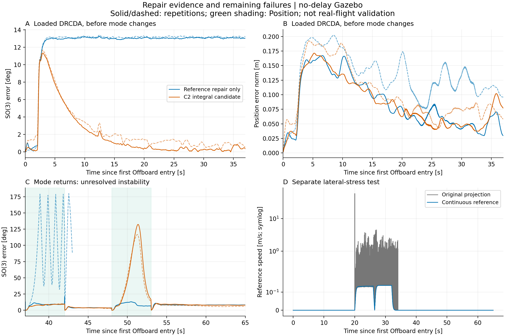

# DRCDA 实机路径修复与无延迟 Gazebo 验证

日期：2026-10-28。**有明确修复和局部改善，但带载 Position 接回仍未通过，不能作为实机自由飞行放行依据。**

> 2026-10-29 校正：下一轮发现 SITL 适配器把质心参考点的 SDF 力矩模型与旧参考点的 CG 重力补偿叠加。现已在适配层修正，原始结果保留。速度尖峰、日志阻塞的修复证据仍在，但本报告的姿态/调参数值只代表当时实现，不能当作已校准模型上的最优参数证明。详见 [下一轮报告](../hardware_transfer_20261029/README.md)。这不是将实机 HNTR_CG 参数清零的建议。

## 结论

| 项目 | 证据 | 结论 |
|---|---|---|
| 限距产生虚假速度 | 同条件闭环压力测试：旧版 59.157 m/s，修复版 0.137 m/s | 尖峰消除；强扰动下跟踪仍超限 |
| 接管日志阻塞 | 同步 fsync 曾阻塞约 100 ms；阻塞磁盘回归通过 | 异步写入，不在控制线程等待磁盘 |
| 无外力跟踪 | 修复组、C1、C2 各两次重复 | 均完成并通过本次 65 s 任务 |
| 持续上拉的姿态误差 | 16–37 s SO(3) RMS：未调参约 13°；C2 为 0.431°、1.090° | 姿态明显改善；位置未一致改善 |
| Position 首帧参考 | 32 次完整返回事件，实际 Hnuter 姿态目标与实测相差小于 0.029° | 旧参考接回缺陷修复 |
| 带载 Position 后续闭环 | C2 第二次接回 SO(3) 峰值约 132°、117°，另有旧增益失稳中止 | **仍失败，首帧连续不等于闭环稳定** |



图 A/B 只评价第一次切回前的 DRCDA；图 C 保留后续失败，蓝色虚线因失稳而中止；图 D 是独立强水平扰动压力测试。虚线是第二次重复，不是置信区间。Position 阶段误差相对该阶段捕获位姿计算，真正的固件目标另外用 `hnuter_control_status` 核对。

## 代码修复

### 连续位置参考

旧逻辑把位置参考投影回距飞机一定范围内，再将投影跳变量除以控制周期当作速度。飞机漂移越大、周期越短，虚假速度越大。新 `_advance_manual_position_reference` 保留原定点参考，只软限制向外继续运动的手柄输入，向内返回不被同样限制；先限速度/加速度，再积分位置，并输出一致前馈。零输入不会随飞机漂移重置定点以掩盖误差。

每次接管重置手动参考速度、诊断节流时间并增加 session ID，短暂第二次接管也能记录；自动任务与手动参考速度状态衔接。实飞记录单步重放为 4.640146 → 0.000386 m/s（相同投影前位置，修复版初始速度为零），这是离线参考生成器证据，不是反事实实飞。合成误差 0.7 m、限距 0.6 m、周期 15 ms、输入 0.0001 m/s 时，结果为 6.667 → 0.0001 m/s。

### 异步事件记录

接管 `_record_event('handover_begin')` 原先同步 flush/fsync，实际发生过接收正常但控制线程被磁盘阻塞，第一帧发布前状态过期、随后请求 Position。新 `AsyncEventWriter` 使用长度 512 的有界队列，复制/序列化事件交给单独线程落盘；满队列与写入错误有计数/警告，不改变模式。正常退出最多等待 2 s；kill -9 或断电可能丢失尚未落盘事件，不保证绝对无丢失。测试覆盖慢 fsync、满队列、写入失败、顺序落盘，以及磁盘阻塞期间实际接管仍发布控制帧。

### 固件 Position 接回

Python 退出后不能替代固件控制，故同时修改对应 PX4：

- direct bypass 期间持续观察控制所有权，清除陈旧积分、RC 初始化、水平/高度锁定、回平及滤波状态。
- 保留空中已解锁时间，避免误作刚解锁起飞；首帧捕获实测位置和完整姿态，不强制水平。
- 不消费接回前缓存的轨迹、姿态和残差；新消息到达前保持捕获位姿。
- 分配器通过模式回调识别退出，等待新鲜力/力矩；用当前 direct session 内有效、新鲜输出初始化历史，首个舵机步长不使用整段 bypass 时间。
- 前电机/尾推力需求做 0.5 s 衔接；尾推力混合位于换向保护之前，未知中位不绕过换向等待。

**剩余不足：**没有将 DRCDA 已建立的全部平衡力矩/积分状态等价植入 Position。带载日志可见后续舵机实测角滞后和偏航加速，但不足以断言单一符号错误。首帧连续和无外力通过不能替代带载稳定性；不能靠放宽判据宣称解决。命令边沿量来自约 0.1 s 间隔的 ULog，不是瞬时 PWM/RPM 连续性的实测证明。

## 实机策略与交付边界

持续独立 Offboard 心跳；手动解锁、手动切 Offboard；接管捕获实测位置/完整姿态；0.5 s 过渡；无自动起飞或姿态幅度门槛。严重数据/数值故障沿用请求 Position、确认退出前不简单停心跳的既有策略。

本轮不启动机载控制器、不修改实机飞控参数、不刷机。新调参方案仅保留为实验计划，**未替换默认硬件调参 JSON**。迁移 Python 不代表机上已有新固件 Position 修复。实飞摘录的 `HNTR_PITCH_BIAS=0.09`、俯仰 D=1.5 与默认硬件配置的 0.07、2.5 不同；本次实验以实际记录为基线，不混称默认值。

## 实验设计

本轮只调试 DRCDA，不比较另外两个分配器。真实 PX4/Gazebo/DDS 运行 hardware v2 路径；适配器仅替换 SDF 电机标定/几何、RC 接线、观察器与仿真时钟，不替换参考生成、积分、接管、发布逻辑。实测关节只记录，分配器仍是 `command_model_only`。SITL 质量 4.5 kg/二级减速比 1 与硬件 4.8 kg/减速比 2 明确分开，不得将仿真配置直接用于实机。

只用无延迟 Tail-SITL，保留原生电机物理/关节 PID，未增加纯延迟或额外一阶舵机滞后。独立 loopback 网络命名空间，ROS domain 174、Agent 8894、127.0.0.1，不向实机发送自动操作。仿真状态年龄使用仿真时钟，另有墙钟停滞检查；实机 watchdog 阈值不变。

仿真操作器起飞约 3 m 并 Position 稳定后执行 65 s 脚本：0–8 定点，8–16 偏航往返，16–20 定点，20–32 左右往返，32–37 定点，37–42 Position，42–48 Offboard，48–53 Position，53–65 Offboard。各组手柄输入、约束相同；调参组只改声明的积分参数。

- 上拉测试：世界系 `[0,0,3]` N，施力点在 FLU 机体系相对 base_link 原点前方 0.2 m，2–51 s 施加。水平时关于该原点俯仰矩为 -0.6 N m；关于整机质心不同。不是已辨识钢绳模型。
- 压力测试：世界系 `[7,0,3]` N、相同施力点/时间，专门触发限距。**不认为真实防坠钢绳具有这个水平力**。

## 参数与结果

C1：位置 Ki `[0.3,0.3,0.2]`、积分状态限幅 `[3,3,2.5]`；姿态 Ki `[0.3,0.4,0.15]`、积分状态限幅 `[1,0.5,1]`。C2 只进一步改姿态 Ki 为 `[0.3,0.8,0.15]`、积分状态限幅 `[1,2,1]`，俯仰积分力矩容量从 0.2 增至 1.6 N m，总力矩/执行器约束不变。依据是 C1 受载时积分状态持续卡在 0.5、姿态误差约 10°。

50 Hz 时间均匀重采样计算 RMS；尖峰另保留原始采样峰值。下表只比较第一次切回前 0–37 s，避免重新捕获位姿导致误差归零污染指标：

| 工况/组 | 位置 RMS，重复 1 / 2 (m) | SO(3) RMS，重复 1 / 2 (°) |
|---|---:|---:|
| 无外力旧版 | 0.0783 / 0.1409 | 1.752 / 0.772 |
| 无外力仅修复 | 0.0899 / 0.0533 | 0.889 / 0.655 |
| 无外力 C1 | 0.0483 / 0.0293 | 0.457 / 1.146 |
| 无外力 C2 | 0.0412 / 0.0523 | 0.474 / 0.849 |
| 上拉仅修复 | 0.0961 / 0.1381 | 12.608 / 12.739 |
| 上拉 C1 | 0.1114 / 0.0984 | 9.779 / 9.801 |
| 上拉 C2 | 0.0948 / 0.1116 | 3.395 / 3.668 |

上拉稳定阶段 16–37 s，C2 姿态 RMS 0.431°/1.090°，仅修复组 13.062°/13.191°；位置 RMS 为 0.0637/0.0752 m 与 0.0624/0.1203 m，**不能宣称位置始终改善**。每组仅两次重复，初始状态/调度有变动，不作显著性结论。C2 两次带载都完成，但后续 Position 姿态/角速度超限，整场 FAIL。仅修复带载重复 2 在首次 Position 后失稳中止；可单独统计此前完整 0–37 s，不能冒充整场完成。

## 保留的失败

[summary.json](evidence/summary.json) 包含全部 21 次尝试，保留原始 PASS/FAIL/INVALID；失稳截断另标 operational FAIL，不将 INVALID 当作算法无问题。

- `pilot01`：原版无外力完成；修复组起飞证据不完整。
- `pilot02`：仿真/墙钟漂移导致假状态陈旧，未完成；未放宽实机阈值。
- `campaign03`：无外力 6 次通过；带载原版首次接管被同步日志阻塞而失败。
- `loaded04`：4 次完成但超限，1 次实际失稳中止；旧版组仅完成 1 次，不虚构第二次。
- `authority05`：C2 无外力 2 次通过，带载 2 次后续切换失败。
- `projection_stress06`：两组跟踪均超限，只有旧版出现虚假速度尖峰。

判据未放宽：位置峰值 0.75 m、SO(3) 15°、倾角 25°、角速度 90°/s、最低高度 1 m、参考速度 0.65 m/s。低于 0.7 m 或速度大于 5 m/s 时仿真中止，保留失败。图中各次接回会重置诊断参考，不用接回后的低误差证明原轨迹跟踪改善。

## 复现

控制器：`controllers/hardware/hnuter_external_direct_drcda_v2_hardware.py`，源模板 `tools/templates/drcda_hardware_v2.py.in`。计划为 `config/experiments/hardware_repair_{no_delay,integral_authority,projection_stress}.json`；实飞控制器参数摘录为同目录 `hardware_repair_flight_tuning.json`，不含完整飞控参数或凭据。旧源通过 `bf9d06b` 与本目录补丁重建并核对 SHA256，需要包含该提交的完整 Git 克隆。

以下只运行隔离仿真，不是实机启动指令：

```bash
cd /home/hnuter/px4_ws_ros2_consolidated
source /opt/ros/jazzy/setup.bash
source /home/hnuter/px4_ws_ros2/install/setup.bash
FW=/home/hnuter/PX4-Hnuter/PX4-Autopilot-Hnuter-tail-sitl
SHA=$(sha256sum "$FW/build/px4_sitl_default/bin/px4" | cut -d ' ' -f1)
python3 tools/experiments/hardware_repair_runner.py \
  --output "$PWD/hnuter_logs/hardware_repair_repeat_$(date +%Y%m%d_%H%M%S)" \
  --plan config/experiments/hardware_repair_integral_authority.json \
  --firmware "$FW" --firmware-sha256 "$SHA" --execute --repeat 2 --group tuned
```

需要 Linux user/network namespace、ROS Jazzy、已构建 px4_msgs、Gazebo、MicroXRCEAgent、numpy/scipy/matplotlib/pyulog。namespace 创建失败会停止，不回退到实机可达网络。核对固件版本/SDF，哈希只证明使用指定产物，不证明任意产物正确。分析工具为 `analyze_hardware_repair.py` 和 `bundle_hardware_repair_report.py`，均在 `tools/experiments`。

## 版本、验证与迁移

- 控制器修复 `bf9d06b`（参考及远程已有修复合并）、`4d945bd`（异步事件）。报告所在提交由 Git 历史确定。
- 固件 main `f8a3ad8a`，`cuav_7-nano_default` 构建通过；产物 SHA256 `178576501ab68b24cb3f8954777c3dff0e69f58c45094b55aeeec826267b3706`，未刷机。
- SITL 既有分支 `codex/payload-selfcalibration-20261010`，提交 `836a4602`，二进制 SHA256 `c5346e77f1026f3028da37e997e964828b584744742266a9993bf2172c491d9d`。
- 早期 campaign03 使用提交前冻结二进制 `482dd2c0d424daee25d1efef4e6ecf4561281130953c0e1b25b80892abb0ca52`，后续为提交后版本元数据重编译，功能源码相同。各次源/配置/产物哈希见 provenance，C1/C2 不合并当成相同参数。
- C++ 接回测试在两个固件仓库通过；Python 结果见 `validation.txt`；独立 DDS 接收测试在隔离 domain 173 通过。

原始仿真 ULog、日志、冻结输入、远程备份保留在本机 `drcda-gazebo/reports/drcda_repair_20261027`；公开目录仅含仿真摘要、精选原始速率曲线、图与复现脚本。机载备份位于 `hnuter_ctrl/backups`。不上传凭据、原始实飞日志或完整飞控参数。

**未完成项：**带载 Position 平衡力矩继承、原生分配/实测关节响应仍需专项闭环修复。当前不是实机试飞放行版本；迁移代码、构建固件、仿真通过、实飞通过是不同证据等级。
