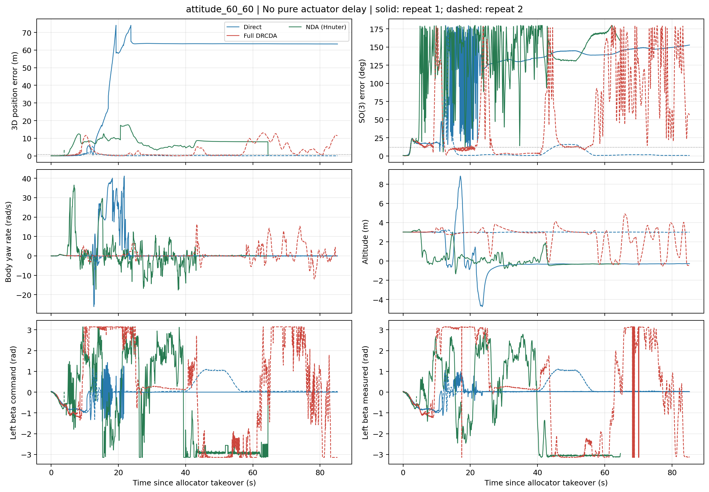
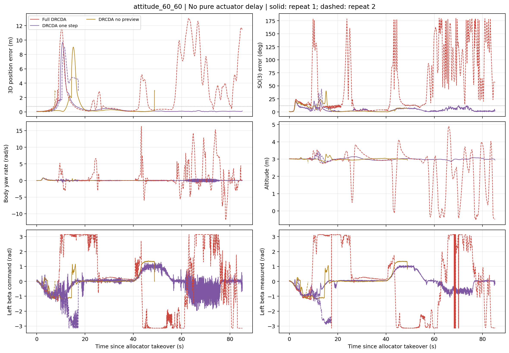
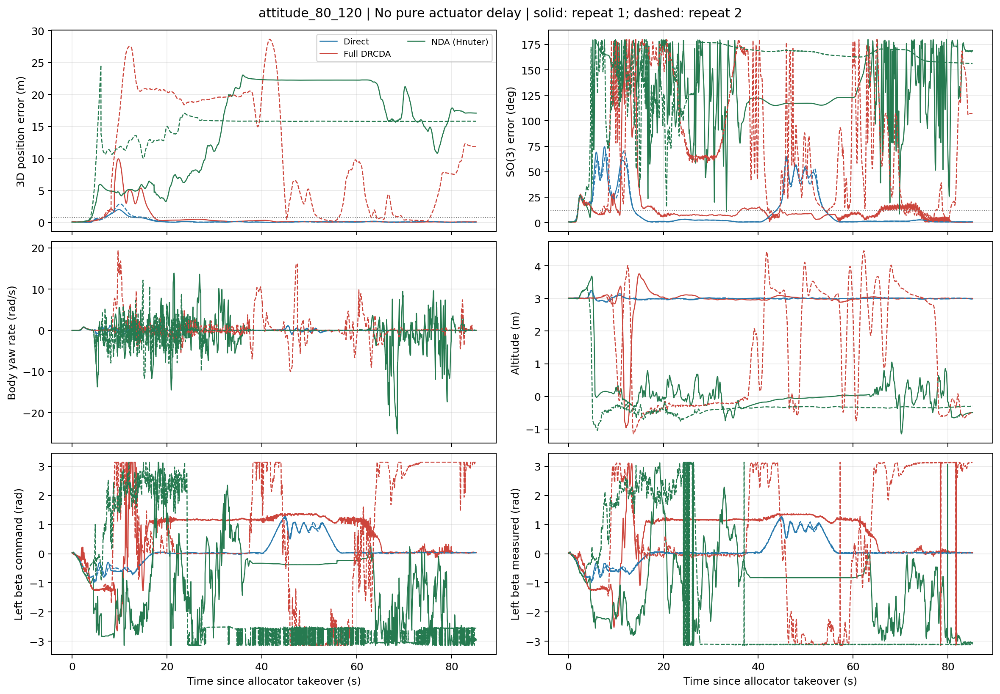
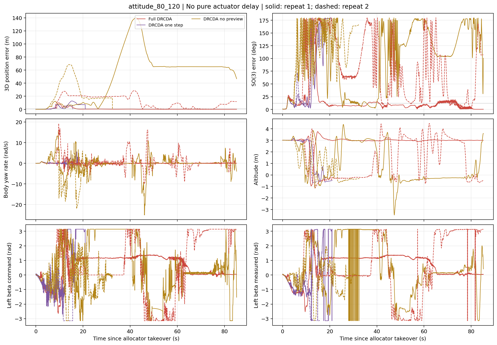
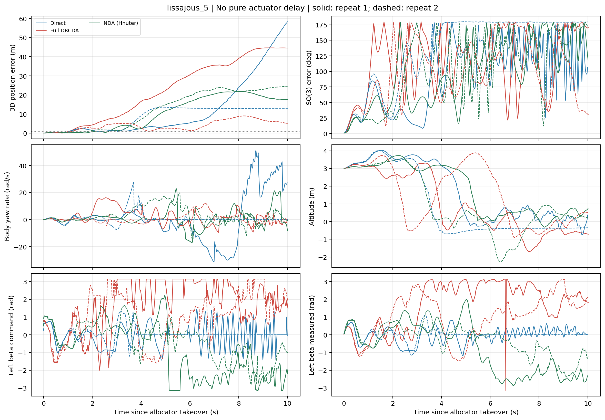
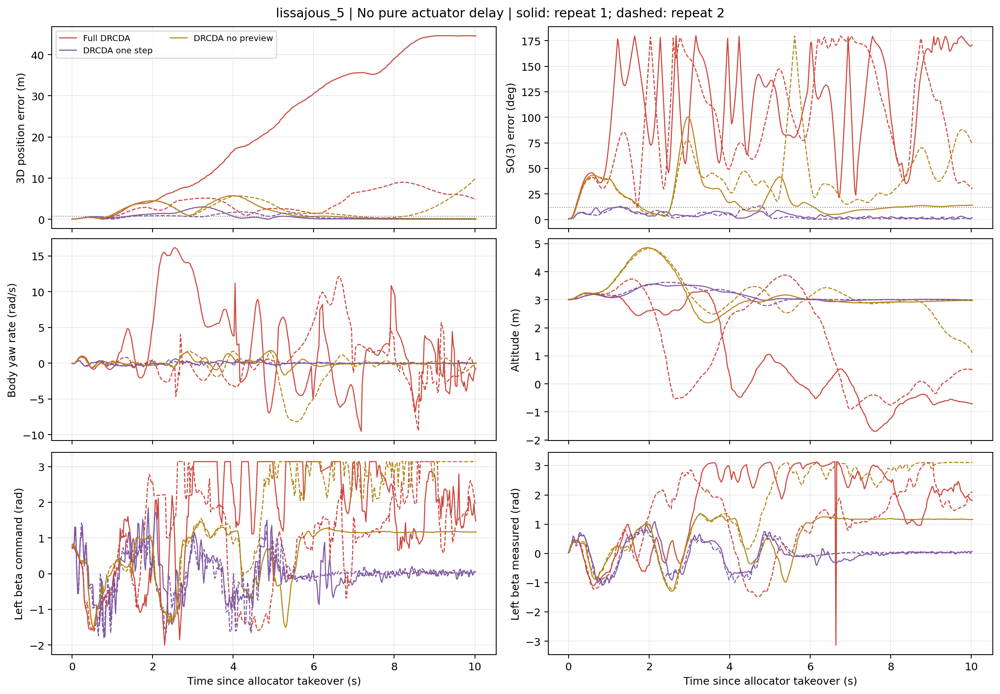
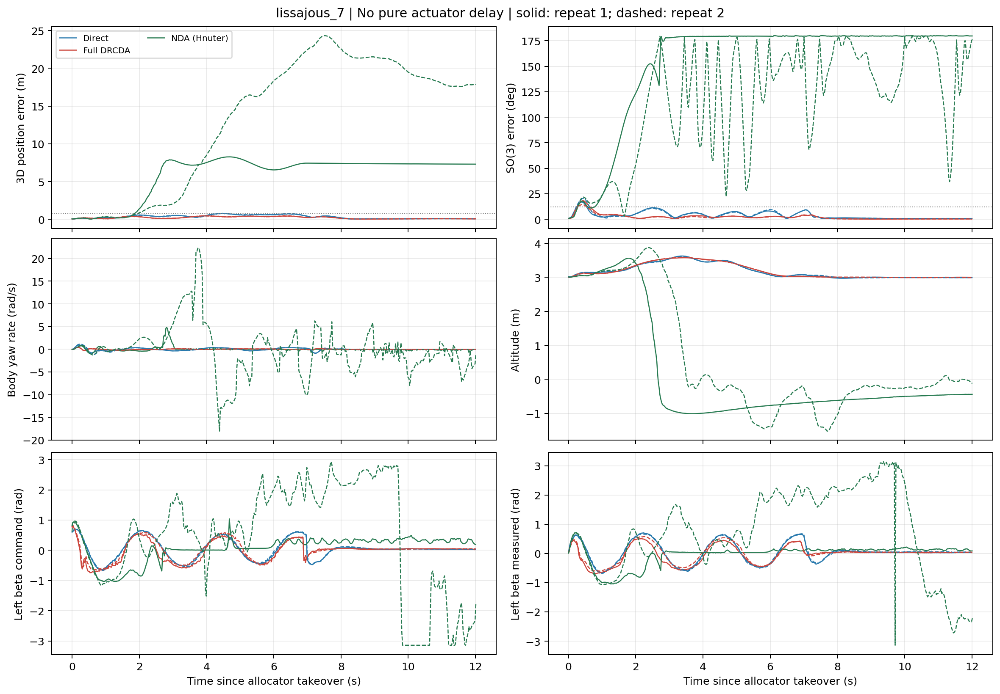
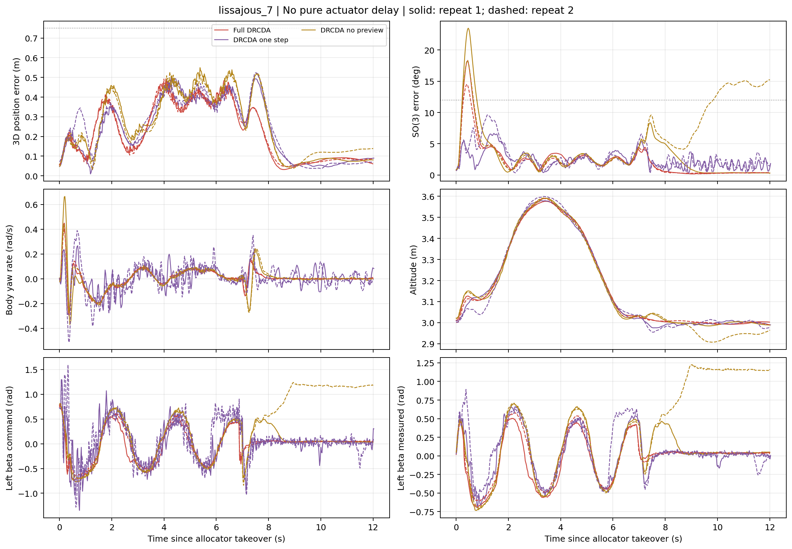
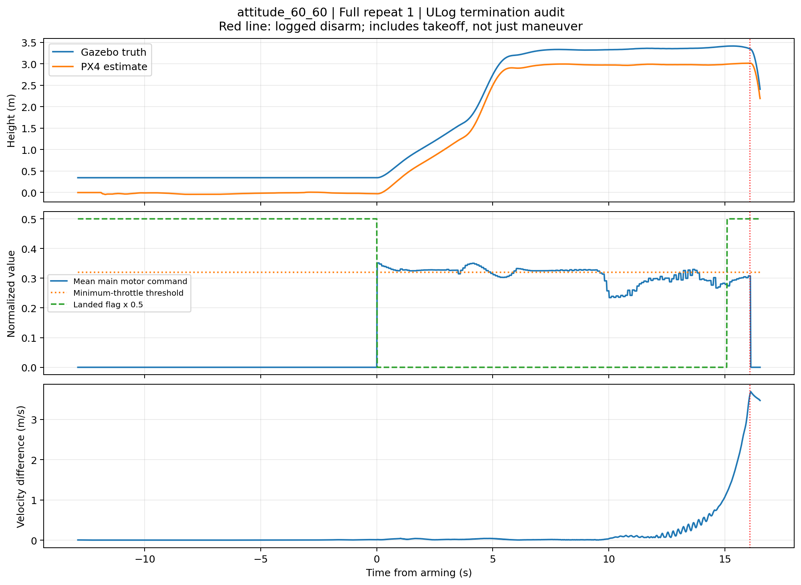

# 3D 李萨如与大姿态悬停：无延迟对比及消融

2026-10-11。此处是对原定姿侧移测试的独立扩展。只使用现有无延迟固件
`/home/hnuter/PX4-Hnuter/PX4-Autopilot-Hnuter-tail-sitl`，源码与 ULog 实际版本分别核验。
没有修改固件，没有使用延迟测试仓库，也没有把执行器动态改成瞬时响应。
Gazebo 原有关节 PID 和电机动态保留。结果是 SITL 证据，不是实机飞行验证。

本轮40次正式运行、20张结果/诊断图；70项相关回归测试通过。
归档CSV离线重绘后，整体指标、分阶段指标、分窗诊断和执行器变化量四份表逐字节一致。

## 先更正原侧移报告

原侧移报告将尾电机命令变化率写成各方法一致的 3500 N/s，不准确。
`HnuterDRCDAController.__init__` 实际将 NDA/DRCDA 尾电机变化率覆盖为 100 N/s，
而原解析分配包装器仍是 3500 N/s。外环 JSON 哈希相同不能排除此类初始化覆盖。
原记录没有改写，但其解析分配比较不再称为严格同约束。

本轮在独立实验入口显式统一为前旋翼 2500 N/s、尾旋翼 **100 N/s**，
并记录实际初始化后的 `runtime_config.json`，不仅比较配置文件本身。
原 NDA/DRCDA 使用的 100 N/s 没有提高，解析分配增加同样的尾电机约束。

## 四项任务

所有方法共同用解析分配起飞，再用 2.5 s 平滑升至 3 m、稳定 1.5 s，之后待测分配器接管。
测评包含完整任务和结束后 5 s 悬停，不在结束后退回解析分配。
每项任务、每个方法执行两次；第二次反转方法顺序。
共同预备段保证初始悬停，但待测分配器直到任务开始才接管：Full不能在接管前提前0.1 s动作。
因此入口峰值包含算法切换，不能单凭它判断持续运行中的预测分配性能。

### 3D 李萨如：7 s 与 5 s

轨迹平面按起始航向旋转，位置相对共同起点 A：

```text
theta = 2*pi*t/T
p_xy = p_A_xy + R_yaw * [1.2*(cos(2*theta)-1), 0.8*(cos(3*theta)-1)]
p_z  = 3.0 + 0.30*(1-cos(theta))
```

解析求导得到速度和加速度。T 分别为 7 s、5 s；姿态参考保持水平、航向不变。
这是原控制器的三维李萨如参考，不是新改成低速的轨迹。
参考的首尾速度为零，但首尾加速度与悬停段不连续，可能贡献边界峰值。
5 s 档局部 y 参考加速度峰值约 11.37 m/s^2，而外环按 NED 分量限制为 8 m/s^2；
实际截断量还取决于初始航向和反馈项。该档属于明显的高负荷压力测试，不能要求零误差。

### 大姿态保持：60/60 与 80/120 deg

固定三维位置，依次执行四段：正横滚、正俯仰、负横滚、负俯仰。
60/60 组角度为 +60、+60、-60、-60 deg；80/120 组为 +80、+120、-80、-120 deg。
每段用 6 s 三次平滑函数到达目标，保持 5 s，用 6 s 返回水平，再稳定 3 s，
总任务时长 80 s。完整任务后额外保持水平 5 s。

保留原大姿态外环的角速度前馈、四元数误差、降阶倾转误差和偏航增益调度；
这些在每个分配方法中完全相同。姿态评价使用 SO(3)，不使用原始欧拉俯仰跳变作为误差。
角度图中的连续俯仰仅为诊断。若前一段已经失稳，后面的顺序姿态段不构成独立轴能力验证。

80/120 组的入口试跑已失稳，因此增加 60/60 组观察较低角度工作区间；
没有删除压力测试，也没有只为 Full 降低参考。正式矩阵开始后没有继续改控制器或调参。

## 方法与公平性

| 方法 | 内容 |
|---|---|
| Direct | 原解析分配，加共同的推力命令变化率限制 |
| NDA (Hnuter) | 前轮已通过悬停资格的采样 NDA：kj=12，旋翼速度次目标增益2，关节姿态次目标增益2 |
| Full DRCDA | 实测关节反馈，0.05/0.10 s 多点目标，权重0.5/1.0，move blocking、两次 Gauss-Newton |
| No preview | 同样时域、模型、权重，但使用当前扳手参考 |
| One step | 相对 No preview 压缩到0.01 s，跟踪总权重仍为1.5 |

Full 对李萨如使用未来位置、速度和加速度生成未来扳手。
大姿态新增只读预测：用当前角速度的 Rodrigues 指数外推姿态，再用未来期望旋转和角速度
计算同一姿态反馈律、增益调度、力矩限幅及重力在预测机体系的投影。
预测调用不更新积分器，不改变实际外环轨迹。
该短时常角速度外推不是完整机体动力学预测，不能据此声称高精度预测大姿态运动。

所有方法共享 `config/simulation/no_delay_drcda_tuning.json`，仅共同把附加残差回算增益设为0；
共享的是外环参数与参考生成规则；由于闭环状态不同，各运行的实际请求扳手不强制逐样本相同。
原外环积分限幅保留。前桨单个上限25 N，尾推力范围 -6.01991 至12.777084 N，
关节角限185/180/185/180 deg，预测器物理角速度界10 rad/s，命令变化率50 rad/s。
四个关节来自 Gazebo 实测反馈；分配器中的旋翼推力仍是模型估计，非实测推力。
NDA/DRCDA用实测角校正内部状态；Direct记录同一实测角用于诊断，不将解析分配改成预测器。

外环约250 Hz。Direct 在外环频率更新，NDA/DRCDA 分配周期设10 ms、通常在12 ms间隔更新。
相同变化率数值按各自更新周期施加，不宣称相同计算频率或连续时间输出斜率；
诊断CSV采样的差分速率也可能因零阶保持和异步采样出现混叠。
NDA 是论文方法的平台适配，不含 PDA 电功率曲线。各方法未做本轮单独的最优增益搜索。

## 判据

正式运行前固定：位置误差峰值不超过0.75 m，SO(3)误差峰值不超过12 deg；
大姿态目标保持段的SO(3) RMS还需不超过5 deg；高度不低于0.5 m，关节有效反馈至少95%，
完成任务、测评期间保持解锁、无安全切断。所有算法使用相同判据，不因某算法失败而放宽。
判据是本实验的工程验收阈值，不是稳定性证明。完整误差窗口包括开始、结束和末段悬停。

## 实测结果

### attitude_60_60

| 方法 | 通过 | 位置峰值/m | SO(3)峰值/deg | 偏航速度峰值/(rad/s) |
|---|---:|---:|---:|---:|
| Direct | 0/2 | 5.519–74.037 | 178.773–179.798 | 7.436–41.138 |
| NDA (Hnuter) | 0/2 | 3.146–17.634 | 24.225–179.995 | 0.796–36.499 |
| Full DRCDA | 0/2 | 3.040–13.054 | 24.218–179.957 | 0.713–16.301 |
| DRCDA no preview | 0/2 | 2.970–9.027 | 20.949–40.262 | 0.777–0.790 |
| DRCDA one step | 0/2 | 9.032–9.672 | 20.937–43.872 | 0.801–0.861 |





[局部误差放大图](figures/attitude_60_60_detail.png)
[姿态参考与实测曲线](figures/attitude_60_60_attitude.png) · [上锁审计](figures/attitude_60_60_termination.png)

### attitude_80_120

| 方法 | 通过 | 位置峰值/m | SO(3)峰值/deg | 偏航速度峰值/(rad/s) |
|---|---:|---:|---:|---:|
| Direct | 0/2 | 2.009–2.901 | 70.553–74.562 | 1.014–1.266 |
| NDA (Hnuter) | 0/2 | 23.028–24.585 | 179.609–179.929 | 12.188–25.130 |
| Full DRCDA | 0/2 | 9.940–28.615 | 179.851–179.986 | 4.177–19.300 |
| DRCDA no preview | 0/2 | 68.376–140.150 | 179.943–179.969 | 22.056–25.103 |
| DRCDA one step | 0/2 | 7.711–12.800 | 179.276–179.970 | 2.157–5.631 |





[局部误差放大图](figures/attitude_80_120_detail.png)
[姿态参考与实测曲线](figures/attitude_80_120_attitude.png) · [上锁审计](figures/attitude_80_120_termination.png)

### lissajous_5

| 方法 | 通过 | 位置峰值/m | SO(3)峰值/deg | 偏航速度峰值/(rad/s) |
|---|---:|---:|---:|---:|
| Direct | 0/2 | 13.625–58.307 | 179.879–179.997 | 28.084–51.185 |
| NDA (Hnuter) | 0/2 | 21.810–24.595 | 179.502–179.616 | 19.783–22.821 |
| Full DRCDA | 0/2 | 9.002–44.618 | 179.715–179.990 | 12.128–16.148 |
| DRCDA no preview | 0/2 | 5.769–10.001 | 100.487–179.760 | 1.770–8.157 |
| DRCDA one step | 0/2 | 1.818–3.039 | 12.100–13.349 | 0.666–0.672 |





[局部误差放大图](figures/lissajous_5_detail.png)
[三维全轨迹](figures/lissajous_5_3d.png) · [三维局部视图](figures/lissajous_5_3d_detail.png)

### lissajous_7

| 方法 | 通过 | 位置峰值/m | SO(3)峰值/deg | 偏航速度峰值/(rad/s) |
|---|---:|---:|---:|---:|
| Direct | 0/2 | 0.796–0.806 | 16.960–20.456 | 0.928–1.178 |
| NDA (Hnuter) | 0/2 | 8.276–24.319 | 179.809–179.999 | 4.815–22.400 |
| Full DRCDA | 0/2 | 0.492–0.493 | 14.514–18.233 | 0.402–0.449 |
| DRCDA no preview | 0/2 | 0.528–0.550 | 18.346–23.494 | 0.439–0.665 |
| DRCDA one step | 2/2 | 0.500–0.523 | 6.653–9.612 | 0.305–0.513 |





[局部误差放大图](figures/lissajous_7_detail.png)
[三维全轨迹](figures/lissajous_7_3d.png) · [三维局部视图](figures/lissajous_7_3d_detail.png)


范围是两次运行的最小至最大值，不是置信区间。因失稳而产生的巨大误差保留，
但不能用它们与正常飞行的平均值拼出夸大的提升百分比。

表中位置和姿态误差来自控制器收到的 PX4 估计状态，不等同于 Gazebo 真值误差。
ULog 审计另外记录真值/估计速度差、对齐初始位置原点后的位移差，以及自动上锁事件。
上锁之后参考或相对高度原点可能重置，因此全窗口失败峰值不是分配器独立误差上界。

### 大姿态组的系统级干扰

当前无延迟固件在 `CA_AIRFRAME=16` 时使用四个主电机归一化指令均值进行着陆检测，
不是使用直接控制器发布的扳手模长提示。ULog 参数为 `HNTR_MOT_HOV=0.4`、
`HNTR_LND_GC_R=0.85`、`HNTR_LND_MIN_R=0.8`，对应低推力阈值0.34和极低推力阈值0.32；
`COM_DISARM_LAND=1 s`。非传统构型在姿态和推力分配变化时，这个均值并不等价于是否接地。

例如60/60组 Full 第一次运行，固件明确记录 `Disarmed by landing`，
事件前 Gazebo 真值高度约3.348 m，PX4估计高度约3.013 m，电机均值约0.308，
估计/真值速度差约3.61 m/s。这是空中误判着陆的证据，不是地面接触证据。
但该次运行在上锁前也已超过姿态阈值，因此不能认为只修复误判就能通过。
真值与EKF高度的零点不同，这两项高度之差不能直接算作高度估计误差。
速度偏差与着陆状态、机体运动的因果先后尚未独立验证，不将它直接认定为另一个独立EKF故障。

本轮没有为任何方法关闭自动上锁、改变着陆参数或使用真值替代EKF；
所有方法保留相同固件参数。故本组是当前完整系统的能力/失败边界比较，
不足以单独证明大姿态下某个分配理论优劣。应先独立校验着陆判据和状态估计，
之后冻结共同条件重新进行分配器因果比较。

## 图与数据

- `figures/*_comparison.png`：三种主方法，全量程，保留失稳过程。
- `figures/*_detail.png`：明确标注的局部量程，只用于看小误差，不替代全量程。
- `figures/*_ablation.png`：Full、无未来参考、单步版本的消融。
- `figures/*_3d.png`：三维轨迹，各自按起点对齐，不做时间拉伸。
- `figures/*_attitude.png`：姿态参考与诊断角度；SO(3)为评价依据。
- `metrics.csv`、`attitude_phase_metrics.csv`、`data/`：运行结果、分阶段诊断、CSV、参数及控制台。
- `lissajous_window_diagnostics.csv`：事后定位用的开始1 s、之后运动段和末段悬停统计，不能代替完整窗口验收。
- `actuation_diagnostics.csv`：诊断采样上的四关节命令/实测总变差，属事后辅助指标；会漏掉采样间快速变化，不能当作真实磨损或能耗，时长不同的中断任务也不能直接横向排名。
- `ulog_metadata.json`：各运行实际固件身份、初始参数、原始ULog哈希；原ULog本体仍在固件日志目录。
- `termination_audit.csv`、各运行的 `ulog_flight_diagnostics.csv` / `ulog_termination.json`：真值对照和上锁审计；原点对齐的估计差不是轨迹误差。
- `figures/*_termination.png`：Full 首次大姿态运行的高度、推力阈值、着陆标志与估计速度差。
- `pilots/`：启动失败与入口试飞，单列，不混入正式统计。
- `verification.json`、`test_results.xml`、`SHA256SUMS.txt`：可复核性检查和回归测试。

CSV沿用侧移诊断格式；`switch_duration_s`是旧侧移参数，不是本次李萨如周期或姿态任务时长。
本轮工况以 `result.json` 的 `scenario`、运行时配置和实际参考/阶段字段为准。

## 复现

```bash
cd /home/hnuter/px4_ws_ros2_consolidated
source /opt/ros/jazzy/setup.bash
source /home/hnuter/px4_ws_ros2/install/setup.bash
OPENBLAS_NUM_THREADS=1 python3 tools/experiments/run_maneuver_validation.py \
  --controller-python /home/hnuter/px4_ws_ros2/px4-venv/bin/python \
  --output "$PWD/hnuter_logs/maneuver_recheck_NEW" --repeat 2
```

单项可增加 `--scenario lissajous_7 --method full --repeat 1 --gui`，输出目录必须是新目录。
驱动自行启动并清理PX4/Gazebo/DDS Agent，不要另起同端口仿真。系统Python需要Pandas供分析使用，
控制器仍在原虚拟环境运行，不新增SciPy依赖。本入口仅用于SITL，不用于实机。

本报告目录中的离线重绘命令：

```bash
python3 analyze_maneuver_extension.py --runs data --output /tmp/maneuver_replot_NEW
python3 audit_maneuver_ulog.py --report /tmp/maneuver_replot_NEW
```

## 结论与证据边界

### 7 s 李萨如：局部提升成立，但 Full 仍未通过

Full 的位置 RMS 为0.2610–0.2615 m，Direct 为0.4094–0.4110 m；
位置峰值分别为0.4918–0.4931 m和0.7960–0.8065 m。该条件下 Full 的位置跟踪确实更好，
且偏航角速度峰值更低。然而 Full 的 SO(3)峰值为14.51–18.23 deg，仍超过12 deg，
所以正式结果为0/2通过，而不是“成功完成了激进飞行验证”。

单步版本位置峰值0.5001–0.5234 m，SO(3)峰值6.65–9.61 deg，2/2通过。
Full 只有小幅位置收益，却有更大的姿态瞬态，不能据此支持有限时域版整体优于单步版。
无未来参考版本的位置 RMS约0.301 m，Full约0.261 m，支持本工况未来参考的局部位置收益；
两者均未通过全窗口判据，不等于整个预测结构已验证可靠。

事后分窗表明，Full 的姿态峰值在接管后约0.42–0.44 s；去掉最初1 s之后的运动段，
其SO(3)峰值约4.51–4.83 deg。这个窗口是看到结果后为了定位瞬态而增加的，
不是另一个通过判据。接管状态与参考加速度不连续都是待分离的因素，尚未建立因果归属。

还存在明显的动作平滑性取舍：同为约12 s的7 s任务加末段悬停，四关节命令的采样总变差，
Full约40.30–40.82 rad，单步约373.35–392.85 rad；实测关节总变差分别约26.39–27.18 rad
和61.96–66.13 rad。曲线中的单步命令高频摆动与此一致。
因此单步通过跟踪判据不代表其执行器动作更优，Full的平滑性也不能抵消超标的姿态瞬态。
这些是事后辅助统计，不是预先设定的通过条件，也不是能耗、磨损或无限带宽抖动测量。

### 5 s 李萨如：当前系统的失败工况

所有方法两次均未通过。Full和Direct均出现显著姿态失稳；单步版本仍未通过位置与姿态阈值，
但在本组保留了更好的姿态和高度表现。不能用Full在较慢任务中的收益外推到这个负荷。
参考加速度已可能超过共同外环限幅，且实际执行器有动态和耦合约束；
本轮没有修改参考、限幅或为某个方法单独调参。

### 大姿态：未建立可靠能力，更不能做纯分配器排名

60/60组所有方法两次均未通过，第一段正横滚已经暴露保持误差、位置漂移或中断。
部分运行空中误判着陆后自动上锁，另一些持续运行但已失去跟踪。
全程走完计时不等于稳定完成，后续姿态段也不能当成独立的正/负俯仰能力验证。

80/120组也全部0/2通过。Direct的SO(3)峰值为70.55–74.56 deg，Full约179.85–179.99 deg，
不存在本组Full整体优于解析分配的证据。
ULog审计在60/60组发现5次高空着陆自动上锁，真值高度约3.18–3.52 m；
80/120组的3次着陆自动上锁均未出现在0.5 m以上，不能把该组失败同样解释为高空误判。
没有上锁的运行也可能已严重失去位置或姿态跟踪，详见全量程曲线和分阶段统计。



### 论文基线与后续优先级

NDA在前轮水平悬停和低速资格测试通过，不意味着在本轮高负荷任务中同样合格。
本轮平台适配NDA的激进飞行失败应完整保留，但不能反向推断原论文方法无效；
模型适配、双轴倾转冗余、采样反演近似和高负荷调参仍是适用范围限制。
本轮没有实现PDA，因此没有“优于论文完整方法”的证据。

下一步应先核对共同系统中的着陆判据和状态估计链，再分离接管瞬态与轨迹边界加速度，
在所有方法共享修正后的条件下重复对比。不能只调Full、只关闭Full的保护或删去其失败段。
本次代码新增的是独立SITL实验入口和诊断，不替换实机hardware控制器，也不修改固件。

