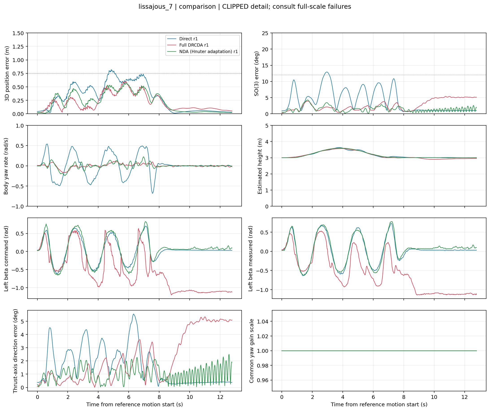
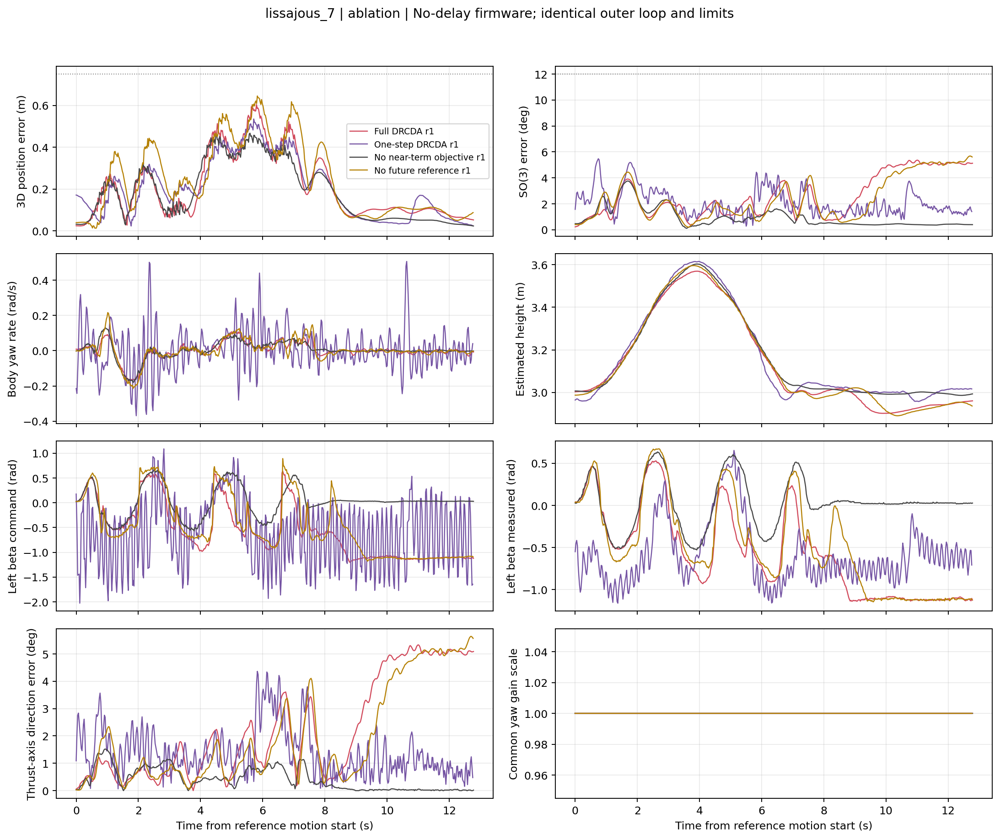
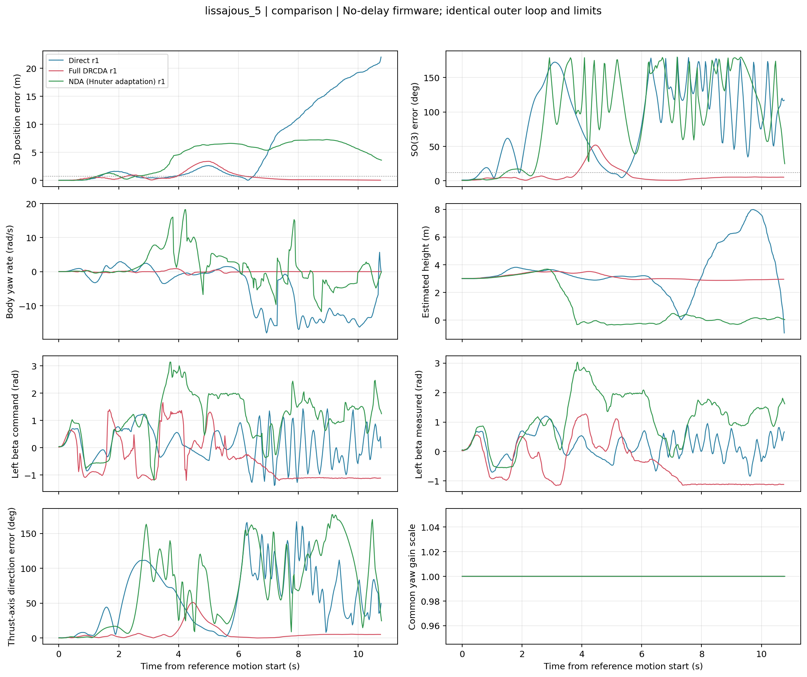
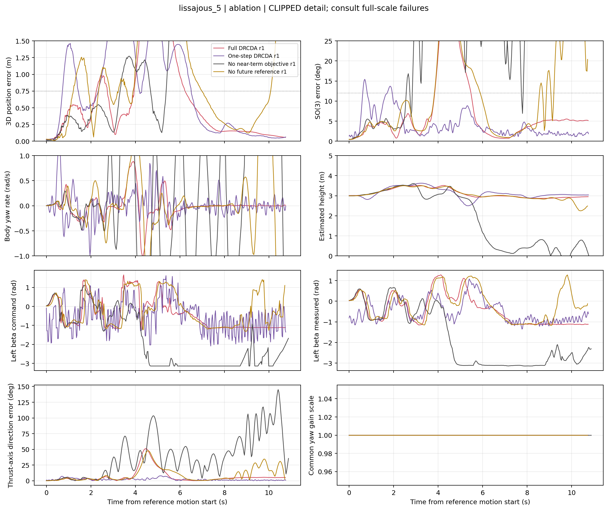
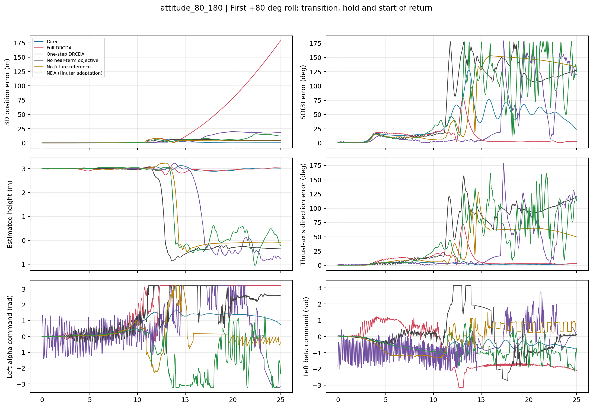
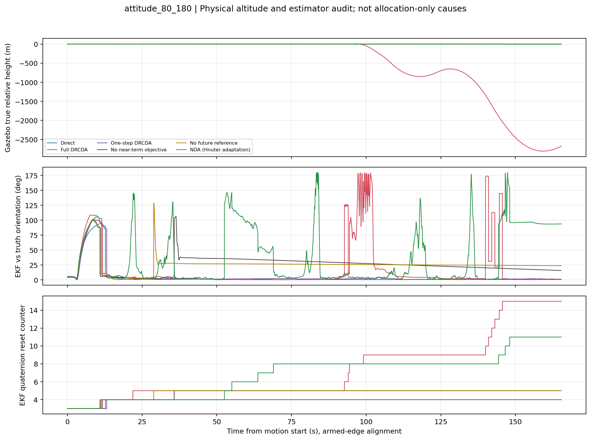

# 无延迟直接分配：修复后机动对比与消融

日期：2026-10-11 至 2026-10-12。**已实际重跑，但大姿态与最激进工况尚未解决，不能宣称 Full 全面优于其他方法。**

## 先看结论

- 全部使用无延迟 `PX4-Autopilot-Hnuter-tail-sitl`，直接发布电机、舵机输入。
- 恢复每项 **15 s 倾转、5 s 保持、15 s 返回、5 s 水平稳定**，测试 +/-80 deg 横滚和 +/-180 deg 俯仰。
- 修复直接 Offboard 的低推力着陆判断、分配几何错误和关节角跨越 +/-180 deg 的反馈支路，调整任务接管时机。
- 正式 18 次同条件比较未出现空中自动着陆上锁。Full 的 7 s 任务入口姿态峰值降到 1.56 deg；旧入口结果为 14.51..18.23 deg，但该前后比较同时包含多项修改，不是单因素归因。
- 7 s 李萨如可见改善；5 s 任务中 Full 保持飞行但误差仍大；原大姿态 Full 仍失稳。不能靠放宽判据把这些失败变成成功。
- 新增近时域项是候选而非最终推荐：它在 5 s 测试中避免坠落，但在 7 s 测试中不如去掉该项。**现阶段没有足够证据证明有限时域本身全面胜过一步分配。**

本轮共 55 次具有任务评估数据的实际 SITL：18 次正式矩阵、2 次最终 NDA 资格、35 次探索。
另外 4 次启动/中断记录单列，不计作飞行失败。每个正式条件仅一次，不做显著性结论。
旧的 40 次扩展实验保留在同级 `extended_maneuvers`，不与本轮混算。

## 共同条件与方法

[完整实现、外环参数、约束、公式与复现命令](METHODS.md)。正式矩阵只有分配方法不同，外环增益和执行器约束相同。
各方法使用同一参考生成器；李萨如起止统一增加 0.75 s C2 相位过渡，运动总时长为 7.75/5.75 s，随后观察 5 s。
这不是未经改动的原 7/5 s 参考，原始无过渡探索数据也保留。

| 名称 | 分配实现 |
|---|---|
| Direct | 解析分配，名义力臂与 SDF 对齐、尾推力命令变化率 100 N/s |
| NDA | 论文微分分配的 Hnuter 采样适配，实测状态、冗余姿态目标；不是完整 PDA 复现 |
| Full | 0.05/0.10 s 两未来扳手目标 + 0.01 s 近时域软目标 |
| No preview | Full 去掉未来参考预见，未来点使用当前扳手 |
| One step | 预测缩短为 0.01 s，保留近时域项 |
| No near-term | 两未来点、去掉新增近时域项，即本轮共同修复后的原 Full 目标 |

Direct 逐外环回调计算，优化分配约 12 ms 更新；不是相同计算频率。
解析方法仍是名义闭式近似，而优化方法使用转动中的完整几何，不能把两者差异全归功于预测时域。
NDA/DRCDA 都不是直接传速度或力矩给 PX4 内部控制器；额外推力话题仅供着陆判断。
逐次 ULog 控制使能核对见 [一致性审计](verification.json)。

## 正式结果

### 7 s 李萨如

| 方法 | 位置 RMS / 峰值 (m) | SO(3) 峰值 (deg) | 严格判据 |
|---|---:|---:|---|
| Direct | 0.394 / 0.821 | 12.93 | 轻微超限，仍全程飞行 |
| NDA | 0.284 / 0.572 | 4.26 | 通过 |
| Full | 0.258 / 0.604 | 5.36 | 通过 |
| No preview | 0.298 / 0.645 | 5.68 | 通过 |
| One step | 0.246 / 0.535 | 5.47 | 通过 |
| No near-term | **0.231 / 0.467** | **3.75** | 通过 |

Full 相对 Direct 的位置 RMS 降低 34.7%，相对 NDA 降低 9.2%；但峰值位置/姿态均不及 NDA。
Full 相对 No preview 的位置 RMS 降低 13.5%，支持该工况下未来参考有帮助。
One step 的位置 RMS 更低，故不能说 0.10 s 时域在所有指标占优。
不过 One step 的采样舵机命令总变差为 822.95 rad，Full 为 52.77 rad；实测关节分别 118.04/32.46 rad。
这是控制活动量，不是能耗或磨损测量，也不能由 20 ms 日志差分推断逐更新限速是否违规。




### 5 s 压力测试

| 方法 | 全程保持空中 | 位置 RMS / 峰值 (m) | SO(3) 峰值 (deg) | 首次真值高度低于 0.5 m |
|---|---|---:|---:|---:|
| Direct | 否 | 失稳后数值不排名 | 约 179 | 7.272 s |
| NDA | 否 | 失稳后数值不排名 | 约 180 | 3.752 s |
| Full | 是 | 1.117 / 3.413 | 51.85 | 无 |
| No preview | 是 | 2.220 / 6.067 | 72.41 | 无 |
| One step | 是 | 1.120 / 2.787 | 15.42 | 无 |
| No near-term | 否 | 失稳后数值不排名 | 约 179 | 6.684 s |

时间从运动参考开始计算，包含运动后 5 s 观察。三个保持飞行的方法也都未达到跟踪标准。
Full 明显好于 No preview，却没有明显优于 One step。新增近时域项在本次试验有避免坠落的收益，
但不能将“未坠落”表述为“跟踪优秀”。原参考 y 加速度约 11.37 m/s2，超过共同 8 m/s2 外环分量限幅；
这是不可精确跟踪的明确来源之一，但不足以解释所有大误差和姿态失稳。




### 15 s 大姿态

**恢复慢倾转仍未使 Full 通过，所以不能再把失败笼统归结为“倾转太快”。**
Full 并非前 65 s 都稳定：位置误差在 9.24 s 已超过 0.75 m、11.74 s 超过 5 m，
之后水平位置严重发散；约 65.96 s 才首次失去高度。NDA、One step、No preview、No near-term 分别约
13.92、16.96、14.32、12.89 s 失去高度。全组严格判据均未通过。

Direct 全程保持空中，两个 +/-180 deg 俯仰峰值保持段 SO(3) RMS 约 1.38 deg，
说明原平台的大俯仰能力仍能复现；但 +/-80 deg 横滚保持段完整姿态 RMS 约 58.6/56.1 deg。
推力轴方向误差较小不代表含航向的完整姿态正确。Direct 不能标为整个任务成功。

本任务还出现 EKF 姿态瞬态/重置。Direct 的估计姿态与真值最大差约 94 deg，
但恢复一致后横滚完整姿态误差仍存在，不能把一切归咎于估计器。
Full 失稳后出现 Gazebo 穿地和大幅状态发散；原始 RMS 保留在 CSV，
不拿这些碰地后的巨大数值计算算法改善百分比。另列首次高度丢失前的指标及各阶段失效标记。




## 哪些原因已查实

1. **入口协议有缺陷。** 原接管和运动开始重合，且仍处于基类 12 s 起飞特殊逻辑内。
   现在先接管悬停、12.5 s 后开始参考，任务结束保留积分和姿态连续性。旧峰值不能证明是分配器单独造成。
2. **几何有确定错误。** 旧臂中心间距 0.66 m，SDF 约 0.82 m；同轴旋翼位置没有随倾转旋转，
   左侧上下顺序、零位轴和尾反扭矩系数也不一致。旧模型可能预测不存在的差动推力力矩。
   新模型加入位置导数对力矩雅可比的贡献，并通过有限差分和独立 Gazebo 运动学核对。
3. **角度反馈存在边界错误。** +/-185 deg 关节不能始终包装到 +/-180 deg，已改连续展开。
   但实际 T5 Full 记录未出现跨支路跳变，不能将它说成此次 T5 失败的直接原因。
4. **未来平衡不等于当前可行。** 同一保持命令可能在预测倾转角下平衡、当前角下不平衡。
   近时域目标尝试减轻这一问题，但只是软约束，本轮结果证明它尚不能提供大姿态稳定性保证。

尚未排除的因素包括：负载下关节动态与一阶预测近似、大角度静态增益外推、
旋翼转速到推力动态近似、EKF 大姿态瞬态，以及 GN 局部求解和冗余支路选择。
不能从现有跟踪曲线断言其中某个是唯一根因。特别是修正几何后部分压力工况更差，
说明不能靠错误模型偶然产生的补偿来证明算法有效。

## 额外候选与资格

- 统一舵机 K=1：7 s RMS 0.219 m，但 5 s RMS 1.447 m，大姿态仍失稳，未提升为默认。
- 近时域三轴力目标：7 s RMS 0.253 m，5 s RMS 1.065 m，大姿态仍失稳，未提升为默认。
- NDA 采用最终模型再次进行 60 s 悬停：位置 RMS 0.020 m、峰值 0.043 m，姿态峰值 0.68 deg。
- NDA 低速 T=20 s 跟踪：位置 RMS 0.067 m、峰值 0.131 m，姿态峰值 1.22 deg，资格通过。

[资格数据](qualification/metrics.csv)；探索试验按批次存于 `exploratory`，包括失败和未采纳修改。
它们是顺序调试实验，不作为随机化独立重复加入正式统计。

## 判据是否过严

严格门槛仍为位置峰值 0.75 m、SO(3) 峰值 12 deg、姿态保持 RMS 5 deg 等，未为结果改门槛。
Direct 的 7 s 结果仅略超门槛，应描述为“完成但精度轻微超限”，不是炸机。
另一方面，5 s 的米级误差和大姿态实际失去高度绝不是门槛导致的失败。
历史部分通过标签按 P95 或更宽保持误差定义，不能与本轮严格通过率直接比较。

## 文件、复现和安全边界

- `metrics.csv`：全部连续指标、严格旗标、真值高度失效时刻和失效前指标。
- `phase_metrics.csv`：逐姿态阶段，明确标记已丢失高度后的阶段。
- `data/`：18 次日志 CSV、运行参数、结果、console、精简 ULog 真值和参数审计。
- `run_manifest.json`：实际源码、固件二进制/SDF 哈希；`provenance/` 保存修改前后代码和补丁。
- `scripts/`：重绘、探索候选和资格复现脚本；`SHA256SUMS.txt` 是归档校验清单。
- 原始 ULog 仍在各 `ulog_metadata.json` 指向的固件日志目录，本报告没有再复制原始 ULog。
  已保存其 SHA256、初始参数和重绘所需精简数据；离线重绘不需要原始 ULog。

可从归档重绘，输出应使用新目录：

```bash
/usr/bin/python3 scripts/analyze_revision.py --runs data --output /tmp/hnuter-revision-replot
```

执行时在本报告目录下运行，需 numpy/pandas/matplotlib/pyulog。飞行复现命令见 METHODS。
新入口为 `controllers.experiments.maneuver_revision`，不是原 v1/v2 或硬件入口已全部替换。
代码测试 231 项通过，SITL 固件编译通过；未刷实机，未提交或推送 Git。
着陆保护在碰地后仍持续请求悬停推力时可能延迟自动上锁，实机正常落地和故障处理还需另行验证。
